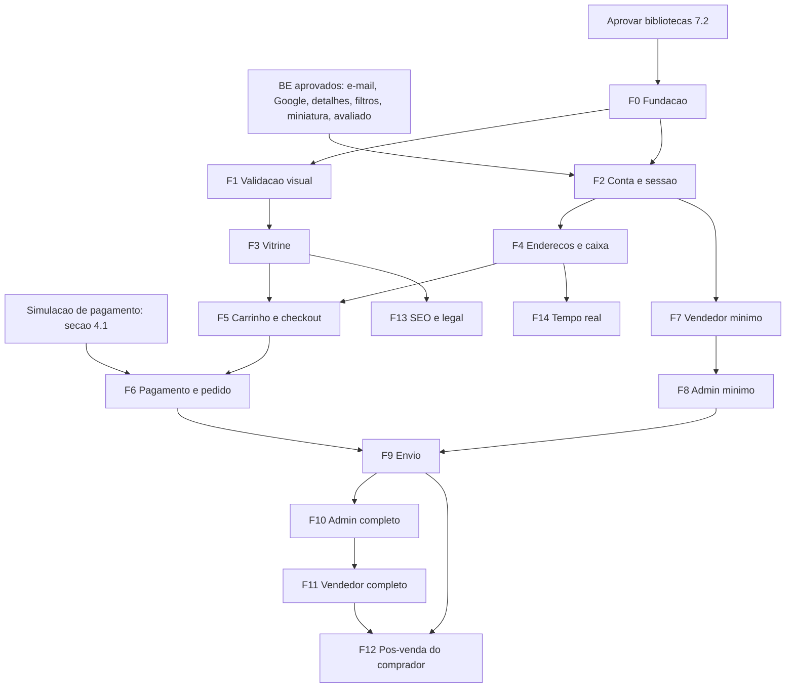

# Roadmap de Implementação — Frontend E-mall

Documento de planejamento do frontend do marketplace. Não descreve código já escrito: o repositório `marketplace-fe` ainda está no template do `create-next-app`.

**Produto:** E-mall  
**Stack aprovada:** Next.js 16.4.5 · React 19.3 · TypeScript · Tailwind CSS 4 · npm · App Router  
**API:** Laravel em repositório separado (`marketplace-php`), contrato em `/api/v1`  
**Situação:** F0 em revisão. Nenhuma tela de produto foi implementada.  
**Data:** 04/11/2026

Origem de cada afirmação:

| Marca      | Significado                                                                 |
| ---------- | --------------------------------------------------------------------------- |
| [Doc]      | Confirmado pela documentação da API                                         |
| [Código]   | Confirmado no código do backend ou do frontend, onde a documentação não diz |
| [Você]     | Decisão sua nesta conversa                                                  |
| [Proposta] | Recomendação ainda não aprovada. Não é decisão                              |
| [Lacuna]   | Informação ausente ou em conflito                                           |

---

## 1. Objetivo e visão do produto

O E-mall é a interface do marketplace já implementado no backend: a própria plataforma vende (loja `is_platform`) e vendedores terceiros vendem no mesmo catálogo. O comprador compara ofertas, compra de várias lojas num pedido só, paga com um pagamento simulado e acompanha cada subpedido. O vendedor opera a loja. O admin modera e opera o dinheiro.

O frontend precisa ser denso, em português, com cara de loja e não de template genérico. A Buy Box, o preço e o estado do pedido vêm da API. O frontend não recalcula vencedor, não confirma pagamento por contagem regressiva e não trata esconder um botão como autorização.

A primeira entrega demonstrável é o ciclo completo pela interface [Você]: cadastro, confirmação de e-mail, vitrine, carrinho com duas lojas, frete, checkout, pagamento simulado, pedido de loja, aprovação, produto, moderação, oferta, envio e acompanhamento. Avaliação, disputa, devolução, saldo e saque vêm depois. A área de admin completa vem antes de aprofundar a área do vendedor [Você].

---

## 2. Documentos analisados e limitações

Lidos por inteiro:

- `marketplace-php/docs/api-referencia.md`
- `marketplace-php/docs/fluxos-e-regras.md`
- `marketplace-php/docs/roadmap-implementacao-api.md`

Também inspecionados: o repositório `marketplace-frontend`, a documentação do Next.js 16 instalada em `node_modules/next/dist/docs`, e os pontos do backend citados na seção 4 (e-mail, Google, resources de pedido, disputa e carrinho).

Limitações:

- O `public/docs/openapi.yaml` não foi lido linha a linha. A geração de tipos (F0) usa esse arquivo como contrato executável. Onde a referência em Markdown e o YAML divergirem, vale o YAML gerado pelo Scribe, e a divergência é registrada antes de seguir.
- O cabeçalho da referência diz "106 rotas, 20/10/2026", mas o corpo já inclui `admin/offers`. A contagem do cabeçalho está desatualizada. Vale o corpo.
- O roadmap do backend mistura plano antigo e implementação. Não entram no frontend: `seller_profiles`, variantes, KYC, cupons, wishlist, chat, perguntas, relatórios de GMV e gateway real.
- O backend não tem `config/cors.php`. Isso deixa de importar para o navegador porque o navegador não chama a API (seção 7). O servidor Next chama a API na rede local.

---

## 3. Decisões confirmadas

| Tema                     | Decisão                                                                                                                                                          | Origem            |
| ------------------------ | ---------------------------------------------------------------------------------------------------------------------------------------------------------------- | ----------------- |
| Nome                     | E-mall. Sem logo por enquanto: o header usa o nome em texto                                                                                                      | [Você]            |
| App                      | Um único app Next para vitrine, comprador, vendedor e admin                                                                                                      | [Você]            |
| Repositório              | `marketplace-fe`, separado da API                                                                                                                                | [Você]            |
| Versões                  | Manter Next 16.4.5, React 19.3, Tailwind 4, npm, App Router                                                                                                      | [Você]            |
| Cache do Next            | Manter `cacheComponents` e `partialPrefetching` ligados                                                                                                          | [Você]            |
| Integração               | Camada no Next (BFF). Tokens só em cookie `httpOnly`. O navegador não vê o Bearer                                                                                | [Você]            |
| Sessão encerrada         | Redirecionar para o login com "Sua sessão terminou." e voltar à página pedida. A API não distingue expiração de login em outro dispositivo; a mensagem é a mesma | [Você] [Doc]      |
| Ambientes agora          | Só local. Não há API publicada. Frontend e API no mesmo domínio-base quando houver publicação (`app` e `api`)                                                    | [Você]            |
| Publicação               | Frontend na Vercel. CI no GitHub Actions                                                                                                                         | [Você]            |
| E-mail de confirmação    | O link passa a abrir o frontend, que chama a URL assinada da API                                                                                                 | [Você]            |
| Google                   | Entrar no fluxo de conta, com `state` validado no `GoogleAuthService`                                                                                            | [Você]            |
| Frete                    | Uma modalidade para o carrinho inteiro. Opção que não atende alguma loja aparece indisponível                                                                    | [Você] [Doc]      |
| Cartão simulado          | A tela mostra as instruções. Não abre `checkout_url`                                                                                                             | [Você]            |
| Primeira jornada         | Ciclo completo pela UI, não só o comprador em cima de seed                                                                                                       | [Você]            |
| Depois dessa jornada     | Admin completo antes de aprofundar o vendedor                                                                                                                    | [Você]            |
| Idioma                   | Só pt-BR. Sem infraestrutura de tradução                                                                                                                         | [Você]            |
| Tema                     | Só claro                                                                                                                                                         | [Você]            |
| Painéis                  | Os mesmos tokens da vitrine. Layout operacional próprio, mais denso, com tabelas                                                                                 | [Você]            |
| Densidade                | Densa, no sentido da Amazon: mais informação por tela, hierarquia forte de preço e ação                                                                          | [Você]            |
| Cor                      | Tons de azul. Evitar cores muito fortes. A paleta da seção 8 é o ponto de partida da validação visual, não a marca fechada                                       | [Você] [Proposta] |
| Cara do produto          | Não copiar Amazon nem Mercado Livre. Não usar o visual padrão de template (fonte Geist, roxo, gradiente, card muito arredondado)                                 | [Você]            |
| Testes                   | Fluxos críticos contra a API real em Docker. Mock só em teste de componente                                                                                      | [Você]            |
| Tipos                    | Gerar do OpenAPI e validar em runtime na borda do BFF                                                                                                            | [Você]            |
| Observabilidade          | Nenhuma ferramenta externa agora                                                                                                                                 | [Você]            |
| Ferramentas de lint      | Manter Prettier 3.3.3. Trocar o script quebrado `next lint` por `eslint .`. Sem hook de pré-commit: o CI barra. `next lint` foi removido no Next 16              | [Você] [Código]   |
| SEO                      | Páginas públicas indexáveis e sitemap                                                                                                                            | [Você]            |
| Acessibilidade           | WCAG 2.2 AA como meta                                                                                                                                            | [Você]            |
| Navegadores              | Chrome, Edge, Firefox e Safari, versões atuais                                                                                                                   | [Você]            |
| Páginas legais           | Termos, privacidade, LGPD e aviso de cookies. O texto jurídico não será inventado                                                                                | [Você]            |
| Backend em PRs separados | Confirmado para os itens da seção 4 marcados como aprovados                                                                                                      | [Você]            |

---

## 4. Pendências e bloqueios

Estas partes do plano não estão fechadas. O restante do documento não depende delas, exceto onde a fase diz "bloqueada".

### 4.1 Bloqueia a demonstração pública do pagamento

[Você] pediu um endpoint de simulação no backend e, ao mesmo tempo, que um visitante de demonstração consiga concluir a compra. [Você] também disse que a API, por enquanto, só existe na máquina local, enquanto o frontend será publicado na Vercel.

Um endpoint que só existe com `APP_ENV=local` não atende um visitante da Vercel. A Vercel também não alcança a API em `127.0.0.1` da sua máquina.

[Proposta], ainda sem aprovação:

- `POST /api/v1/orders/{order}/payments/{payment}/simulate`
- Corpo: `{ "outcome": "paid" | "failed" }`
- Só o comprador dono do pedido.
- Ligado pela flag `PAYMENTS_MOCK_BUYER_SIMULATE` (ligada no local e, no futuro, no ambiente de demonstração; desligada quando houver gateway real).
- Não usa o segredo do webhook. O servidor aplica o mesmo efeito do webhook mock.
- A demonstração pública continua impossível até a API ter um host acessível pela Vercel. Esse host não foi escolhido.

A fase F6 descreve a tela em cima desse contrato, e a tarefa de ligar o botão fica bloqueada até você confirmar a flag e o formato.

### 4.2 Bibliotecas (seção 7.2)

Você pediu a lista mínima antes de fechar. A F0 não começa até você aprovar ou trocar essa lista. Trocar uma biblioteca não muda rotas, critérios de aceite nem a matriz da API.

### 4.3 O que você pediu para eu não deduzir (Q27)

A pergunta era se estes três itens ficam fora da interface:

| Item                                       | O que é                                                                                         | [Proposta]                         |
| ------------------------------------------ | ----------------------------------------------------------------------------------------------- | ---------------------------------- |
| `POST/DELETE /offers/{offer}/reservations` | Reserva avulsa de 15 minutos. O checkout já reserva o estoque. Não há tela de "segurar produto" | Fora da UI                         |
| `GET /users`                               | Lista usuários, só admin. Não há endpoint para editar, promover ou desativar                    | Fora da UI                         |
| `GET /up`                                  | Health check de banco e Redis, para monitoramento da API                                        | Fora da UI. O CI do backend já usa |

Se você discordar, as telas correspondentes entram numa fase nova. Até lá, não há tarefa de interface para eles.

### 4.4 Escolhas de plano sujeitas a veto

Não estavam na documentação. Estão no plano para ele ser executável. Um "não" troca a linha, sem refazer as fases.

| Escolha                                                              | Motivo                                                                                           |
| -------------------------------------------------------------------- | ------------------------------------------------------------------------------------------------ |
| Paginação da vitrine com "anteriores / próximos" e o `cursor` na URL | A API não informa o total de páginas. URL compartilhável funciona com Server Component           |
| Rota de confirmação `/confirmar-email`                               | Os e-mails já usam caminhos em português (`/redefinir-senha`)                                    |
| Login em `/entrar`, cadastro em `/cadastrar`                         | O mesmo critério                                                                                 |
| Busca em `/busca`                                                    | O header precisa de um destino. A API só filtra com `q` em `/products`                           |
| Paleta e a fonte Source Sans 3 da seção 8                            | Ponto de partida da validação visual, não a identidade fechada                                   |
| Preço em azul-marinho, não em vermelho                               | Vermelho forte contradiz o pedido de evitar cores muito fortes. A validação visual pode reverter |

### 4.5 Propostas de backend ainda não aprovadas

Não viram tarefa de frontend nem PR até um "sim".

| ID    | Proposta                                                                                                                            | Por que                                                                                                                                            |
| ----- | ----------------------------------------------------------------------------------------------------------------------------------- | -------------------------------------------------------------------------------------------------------------------------------------------------- |
| BE-P1 | `GET /api/v1/catalog/home` com categorias raiz, produtos mais recentes e um bloco da loja `is_platform`                             | A home não tem endpoint. Dá para compor 2 chamadas, mas ninguém informa qual é a loja da plataforma sem varrer o catálogo                          |
| BE-P2 | `sort` (`newest`, `price_asc`, `price_desc`) e filtro de faixa de preço em `GET /products`                                          | A listagem só ordena por mais recente [Doc]. Pesquisa de varejo trata preço como filtro essencial (seção 8). Não será exibido enquanto não existir |
| BE-P3 | Feed de sitemap: produtos, categorias e lojas ativas, paginado por cursor                                                           | Você pediu sitemap. A listagem pública não devolve o total e o slug da loja da plataforma não tem endpoint próprio                                 |
| BE-P4 | Tempo real da caixa de notificações com Laravel Reverb, canal privado por usuário e endpoint de autorização do canal                | Não há WebSocket hoje [Doc]. A seção 4.6 descreve a proposta                                                                                       |
| BE-P5 | Reapresentar o mesmo refresh token durante uma janela curta (cerca de 30 s) devolver o par já emitido, em vez de invalidar a sessão | Na Vercel há mais de uma instância. Dois refresh simultâneos derrubam a sessão, porque o login/refresh apaga os pares anteriores [Doc]             |
| BE-P6 | `store.is_platform` no subpedido do pedido                                                                                          | O bloco `store` de `OrderSellerResource` não traz a flag [Código]. A vitrine traz                                                                  |

### 4.6 Tempo real (proposta BE-P4)

[Doc] a caixa é `GET /notifications` e `GET /notifications/unread-count`. Não há canal ao vivo.

[Proposta] Laravel Reverb, que é o servidor WebSocket de primeira parte do Laravel:

- Evento já existente, depois do commit, também faz broadcast em canal privado `users.{id}`.
- O Next autentica o canal por uma rota sua, que usa o cookie de sessão e pede a autorização à API.
- O cliente atualiza o contador e prepende o item.
- Se o socket cair, a caixa continua correta no próximo carregamento. Não há polling permanente como plano principal.

Até essa proposta ser aprovada, a caixa atualiza na navegação e quando o usuário abre o painel. A fase F14 fica bloqueada.

---

## 5. Princípios de priorização

1. A jornada que prova o negócio vem antes do painel completo. Com a decisão [Você] do ciclo pela UI, a jornada inclui uma fatia fina de vendedor e de admin, não os painéis inteiros.
2. Nada na tela promete um dado que a API não devolve. Filtro de preço, "mais vendidos", autocomplete e frete estimado no card ficam de fora até existir endpoint.
3. O backend é a fonte da verdade de preço, estoque, Buy Box, papel e estado. O frontend só espelha e explica.
4. Cada fase termina demonstrável, com teste do que ela arrisca (dinheiro, sessão, autorização, estoque).
5. Dependência de backend tem ID `BE-*` e não entra na lista de tarefas `F*`.
6. Densidade não é desculpa para texto miúdo sem contraste, alvo de toque menor que 24 px ou ação principal escondida.

---

## 6. Escopo e fora de escopo

### 6.1 Essencial para a primeira jornada

Cadastro, login, logout, confirmação de e-mail, sessão, endereços, vitrine (home possível com a API atual, categoria, busca, listagem, detalhe, Buy Box, outras ofertas, avaliações públicas, loja), carrinho, cotação, checkout, pagamento simulado, pedido, cancelamento em `pending_payment`, pedido de loja, aprovação e rejeição de loja, produto com imagens e atributos, moderação de produto, oferta, pausa de oferta pelo vendedor, envio e entrega, rastreio para o comprador.

Google entra na fase de conta (F2). A jornada de compra pode ser demonstrada sem Google enquanto `GOOGLE_CLIENT_ID` estiver vazio, porque a API responde 503 [Doc].

### 6.2 Cobertura funcional, depois da jornada

Admin completo (categorias, ofertas, pedidos, reembolsos, saques, disputas, devoluções). Vendedor completo (trava de moderação, saldo, extrato, saque, disputa, devolução). Comprador: avaliação, disputa, devolução, histórico de pagamento. SEO, sitemap, páginas legais. Tempo real, se a proposta for aprovada.

### 6.3 Fora do escopo enquanto a API não tiver

Cupom, wishlist, chat, perguntas, anúncio patrocinado, relatório de GMV, variante, KYC, edição de perfil, troca de senha logado, exclusão de conta, carrinho de visitante, gateway real, frete real, tema escuro, outros idiomas.

### 6.4 Fora da UI, se a seção 4.3 for confirmada

Reserva avulsa, listagem de usuários, health check.

---

## 7. Arquitetura

### 7.1 Aprovada

O navegador fala só com o Next. O servidor Next fala com a API Laravel usando `Authorization: Bearer`. O contrato Bearer documentado não é trocado por cookie de sessão do Sanctum.

```text
navegador -- cookie httpOnly --> Next (Server Component, Server Action, rota de upload)
Next -- Bearer, Idempotency-Key, sem segredo de webhook --> API /api/v1
```

Cookies:

| Cookie              | Conteúdo                                    | Vida                          |
| ------------------- | ------------------------------------------- | ----------------------------- |
| `emall_access`      | access token                                | até 1 h, igual à API          |
| `emall_refresh`     | refresh token                               | até 30 dias                   |
| `emall_oauth_state` | state do Google                             | 10 min                        |
| `emall_idem`        | chave de checkout ou pagamento em andamento | até o resultado ser conhecido |

Todos `HttpOnly`, `SameSite=Lax`, `Secure` fora de local, `Path=/`. Nenhum token vai para `localStorage`, para a query string ou para o HTML.

Sessão:

- Uma sessão por usuário, porque a API apaga os pares anteriores [Doc].
- O refresh passa por uma única função no servidor. Abas usam o cookie novo. Não há lock compartilhado entre instâncias da Vercel: isso é o buraco do BE-P5. No `next dev` (um processo) o lock em memória basta para o desenvolvimento.
- Access token vencido: uma tentativa de refresh. Se falhar, apaga os cookies e redireciona para `/entrar?next=<caminho relativo>` com o aviso. `next` só aceita caminho interno, para não virar open redirect.
- Logout chama `POST /auth/logout` e apaga os cookies mesmo se a API falhar.

Rotas e proteção:

- `proxy.ts` (o `middleware.ts` foi descontinuado no Next 16 [Código]) só verifica se o cookie existe nas áreas privadas. Não lê papel: o token é opaco.
- O layout do servidor chama `GET /users/me`. Sem papel `seller`, `/vendedor/*` explica que a loja não está ativa. Sem papel `admin`, `/admin/*` responde 403.
- Com `cacheComponents`, leitura de cookie fica dentro de `<Suspense>`. O miolo público da página (categoria, busca, detalhe) continua pré-renderizável. O header com o nome do usuário fica no bloco dinâmico.
- Dados privados não usam `use cache`. Cache de catálogo público usa `use cache` com tag por recurso, sem cookie dentro da função cacheada.

Mutações:

- Server Actions para as ações de domínio. O Next recusa POST de outra origem.
- Upload de imagem é a exceção: rota `POST` do Next que confere a origem, limita o tamanho e repassa o multipart. A API aceita até 2 MB e 8 imagens [Doc].
- Erros da API viram um tipo único (`status`, `message`, `errors`, `retryAfter`). A tela não mostra stack.

Idempotência:

- Checkout e criação de pagamento exigem `Idempotency-Key` [Doc].
- A chave nasce no servidor, no primeiro envio da intenção, e fica no cookie `emall_idem` ligada ao tipo e ao id (carrinho ou pedido).
- Timeout ou 5xx reutiliza a mesma chave. Replay 200 mostra o mesmo pedido ou pagamento, sem segunda compra.
- Chave nova só quando a intenção muda: outro endereço, outra modalidade, outro método, ou o carrinho foi alterado.
- O botão desabilitado é só visual. A proteção é a chave.

Dinheiro:

- Exibir sempre a partir de `*_cents`, com `Intl.NumberFormat('pt-BR', { style: 'currency', currency: 'BRL' })`.
- Oferta e carrinho também trazem reais em string [Doc]. A string é ignorada na formatação, para não haver duas fontes.
- O formulário de oferta envia reais com duas casas, como a API exige. A conversão da entrada pt-BR (`1.799,90`) para `"1799.90"` acontece no cliente, antes do envio.

Envelopes, tratados na borda:

| Forma                             | Onde                         |
| --------------------------------- | ---------------------------- |
| `{ data, links, meta }`           | coleções com cursor          |
| `{ data }` ou `{ data, message }` | recurso                      |
| `{ user }`                        | `GET /users/me` e o cadastro |
| tokens no topo                    | login, refresh, Google       |
| `buy_box` ao lado de `data`       | detalhe do produto           |
| `products` ao lado de `data`      | vitrine da loja              |

Pastas:

```text
app/
  (vitrine)/                home, busca, categoria, produto, loja
  (conta)/                  entrar, cadastrar, senha, confirmar e-mail
  (comprador)/              carrinho, checkout, pedidos, endereços, notificações
  (vendedor)/
  (admin)/
  entrar/google/callback/
components/
  ui/                       primitivos, sem regra de negócio
  catalog/  commerce/  account/  seller/  admin/
lib/
  api/                      cliente, erros, tipos gerados, parsers
  auth/                     cookies e refresh
  money/
proxy.ts
```

Grupos `(vitrine)` e similares não aparecem na URL. As URLs públicas estão na seção 10.

Variáveis:

| Variável              | Onde vive | Uso                                      |
| --------------------- | --------- | ---------------------------------------- |
| `API_URL`             | servidor  | base da API, ex. `http://127.0.0.1:8080` |
| `NEXT_PUBLIC_APP_URL` | público   | URL deste app, para metadata             |

Sem `NEXT_PUBLIC` para token, segredo de webhook ou flag de simulação. A flag fica na API.

### 7.2 Bibliotecas propostas

A F0 seguiu esta lista. Entraram no projeto só as peças que a fundação usa: `openapi-typescript`, Zod, Vitest, `server-only` e `tsx`. React Hook Form, Radix, Phosphor, Testing Library, MSW, Playwright e axe entram na fase que primeiro precisa deles.

Lista mínima. Cada item existe porque o Next 16 não cobre o caso.

| Necessidade                                     | Proposta                                                    | Por que não outra coisa                                                                                           |
| ----------------------------------------------- | ----------------------------------------------------------- | ----------------------------------------------------------------------------------------------------------------- |
| Tipos da API                                    | `openapi-typescript` a partir de `public/docs/openapi.yaml` | Você pediu geração. Tipos escritos à mão divergem do Scribe                                                       |
| Validação de resposta e de formulário           | Zod, na borda do BFF e nos formulários                      | Você pediu validação em runtime. Um validador só                                                                  |
| Formulários                                     | React Hook Form                                             | Produto com atributos dinâmicos, oferta e checkout têm estado local. Server Action recebe o resultado já validado |
| Componente acessível de diálogo, menu e popover | Radix UI, sem o tema visual do shadcn                       | O visual padrão do shadcn é o "cara de template" que você não quer. O Radix só entrega comportamento e teclado    |
| O resto dos componentes                         | Feitos no projeto, com Tailwind                             | Botão, campo, card, tabela, preço                                                                                 |
| Ícones                                          | Phosphor, peso regular, conjunto pequeno                    | Lucide junto de card arredondado reforça o visual genérico                                                        |
| Teste de componente                             | Vitest + Testing Library + MSW                              | MSW só aqui, não no E2E                                                                                           |
| E2E                                             | Playwright contra a API no Docker                           | Decisão sua                                                                                                       |
| Acessibilidade automatizada                     | `@axe-core/playwright` nos fluxos E2E                       | Cobre o que o teste de clique não vê                                                                              |
| Data e moeda                                    | `Intl` nativo                                               | Evita date-fns e lib de máscara                                                                                   |
| Cache de servidor da API                        | `use cache` do Next                                         | TanStack Query ficaria duplicado com o cache do Next. Não entra nesta lista                                       |

Não entram agora: Redux, Zustand, TanStack Query, biblioteca de CSS-in-JS, kit de UI completo, Sentry, analytics.

### 7.3 Renderização

| Tipo de página                                    | Onde renderiza                       | Cache                                                        |
| ------------------------------------------------- | ------------------------------------ | ------------------------------------------------------------ |
| Home, categoria, busca, produto, loja, avaliações | Servidor                             | `use cache` do miolo público. Header de sessão fora do cache |
| Carrinho, checkout, pedido, painéis               | Servidor, dinâmico, com cookie       | Sem cache compartilhado                                      |
| Login e cadastro                                  | Servidor + formulário cliente        | Sem cache                                                    |
| Upload e reordenação de imagens                   | Cliente, porque é interação contínua | —                                                            |

---

## 8. Direção visual e design system

### 8.1 O que vem de pesquisa, e o que é proposta

Observado em pesquisa pública de varejo (Baymard Institute, artigos de 2024–2026 sobre listagem e página de produto; não é design system interno da Amazon nem do Mercado Livre):

- O card precisa de preço, título, miniatura e avaliação com contagem. Sem preço, a pessoa ignora o item.
- Preço e preço promocional ficam juntos. O preço pago é o que domina. O anterior usa riscado. O desconto não se repete em três lugares.
- O custo de frete é uma dúvida real na página do produto. A nossa API só cota frete com CEP e carrinho [Doc]. A página não inventa um valor: diz que o frete é calculado no carrinho, por loja.
- Filtro de preço, nota, cor e tamanho aparece como expectativa de loja. Aqui só existem categoria, loja, texto e atributos filtráveis [Doc]. O que não existe não ganha controle.
- Página de produto longa funciona melhor com seções empilhadas e títulos claros do que com abas horizontais.
- Densidade demais, sem agrupamento, faz a pessoa deixar de enxergar o preço. O pedido de densidade da Amazon vale dentro de uma hierarquia, não como grade uniforme.

[Proposta] de estrutura, misturando as referências sem copiar a moldura delas:

- Da Amazon, a densidade: header com busca larga, resultado em grade, Buy Box numa coluna estável com vendedor, preço, estoque e um botão primário.
- Do Mercado Livre, a leitura do anúncio: preço grande, condição da oferta legível, loja com nome e reputação perto da ação.
- De nenhum dos dois: a cor. Sem faixa amarela, sem laranja de ação, sem azul elétrico.

### 8.2 Ponto de partida para a validação (F1)

Não é a marca fechada. A F1 existe para você olhar e corrigir.

| Token            | Valor                      | Uso                                   |
| ---------------- | -------------------------- | ------------------------------------- |
| `canvas`         | `#f3f5f8`                  | fundo da página                       |
| `surface`        | `#ffffff`                  | card, formulário, tabela              |
| `ink`            | `#1a2332`                  | texto e preço                         |
| `ink-soft`       | `#5c6b7e`                  | meta, placeholder                     |
| `line`           | `#d5dbe3`                  | borda e divisória                     |
| `header`         | `#1e3a5f`                  | barra superior, azul profundo         |
| `header-ink`     | `#f4f7fb`                  | texto na barra                        |
| `action`         | `#2f6fad`                  | botão primário e link                 |
| `action-ink`     | `#ffffff`                  | texto do botão                        |
| `promo`          | `#3d6b4f`                  | selo "promoção", verde apagado        |
| `danger`         | `#8f3d3d`                  | erro e ação destrutiva                |
| `warning`        | `#8a6a2f`                  | prazo e pendência                     |
| `star`           | `#a6843d`                  | estrela de avaliação                  |
| Fonte            | Source Sans 3              | texto de UI. Não usar Geist nem Inter |
| Corpo            | 14 px / 20 px              | densidade sem cair abaixo de 14 px    |
| Preço no card    | 18 px, semibold            |                                       |
| Preço na Buy Box | 28 px, semibold            |                                       |
| Raio             | 4 px                       | canto pouco arredondado               |
| Sombra           | nenhuma no card; só `line` | sombra suave só em menu e diálogo     |
| Largura          | 1200 px                    | miolo                                 |
| Grade            | 8 px                       | espaçamento 4, 8, 12, 16, 24          |

Evitar: gradiente, vidro fosco, ilustração de pessoas em 3D, emoji no lugar de ícone, hero com três cards de benefício, botão em cápsula, fundo colorido em toda a página.

Estados de estoque e oferta, sempre com texto, não só cor:

- sem ofertas compráveis;
- última unidade (`available_stock === 1`);
- promoção com início e fim visíveis;
- loja da plataforma com o texto "Vendido pelo E-mall", a partir de `is_platform`.

### 8.3 Breakpoints

Os do Tailwind: 640, 768, 1024, 1280. Mobile primeiro no código. A referência densa é a largura de 1280.

| Largura  | Listagem                                    | Produto                                                     | Tabela operacional                                     |
| -------- | ------------------------------------------- | ----------------------------------------------------------- | ------------------------------------------------------ |
| < 768    | 2 colunas, busca no header em linha própria | Buy Box abaixo da galeria, botão fixo no rodapé da viewport | cada linha vira um bloco com rótulos                   |
| 768–1023 | 3 colunas                                   | galeria e Buy Box lado a lado                               | tabela com scroll horizontal e primeira coluna legível |
| ≥ 1024   | 4 ou 5 colunas                              | galeria, dados, Buy Box                                     | tabela cheia                                           |

### 8.4 Peças

Primitivos: botão, campo, select, checkbox, rádio, textarea, diálogo, menu, popover, aviso inline, preço, badge de status, paginação por cursor, esqueleto, vazio.

De domínio: card de produto, Buy Box, linha de oferta, linha de carrinho por loja, resumo de pedido, status de subpedido, formulário de endereço, tabela operacional.

### 8.5 O que a F1 mostra antes de espalhar

Header e busca, card, detalhe com Buy Box, carrinho com duas lojas, um formulário (endereço) e uma tabela (pedidos do admin), em 360 px e em 1280 px. Dados fixos, sem API. Você aprova ou corrige os tokens antes da F3.

---

## 9. Perfis e jornadas

| Perfil                               | Entra como                          | O que a interface precisa deixar óbvio                                                           |
| ------------------------------------ | ----------------------------------- | ------------------------------------------------------------------------------------------------ |
| Visitante                            | sem cookie                          | navegar, buscar, ver preço e loja. Ação de compra leva ao login e volta                          |
| Comprador                            | `buyer`, e-mail pode estar pendente | comprar, pagar, acompanhar. Checkout, pedir loja e saque explicam o 403 de e-mail não confirmado |
| Comprador com loja                   | `buyer` + `seller`                  | os dois menus. Comprar não remove a operação da loja                                             |
| Loja pendente, rejeitada ou suspensa | sem papel `seller` [Doc]            | o estado da loja e o motivo. Sem menu de operação                                                |
| Admin                                | `admin`, criado fora da API [Doc]   | filas de moderação e dinheiro. Sem atalho para "virar admin" na UI                               |

Jornada da primeira entrega:

```text
Comprador cadastra e confirma o e-mail
  → pede loja
  → admin aprova
  → vendedor cria produto, envia imagens, submete
  → admin aprova o produto
  → vendedor publica oferta
  → outro comprador busca, vê a Buy Box, monta carrinho de duas lojas
  → cota o frete, escolhe uma modalidade, faz checkout
  → gera Pix, boleto ou cartão simulado e a simulação confirma
  → vendedor envia e marca entregue
  → comprador vê o rastreio e o estado delivered
```

---

## 10. Mapa de rotas e telas

"Auth" é o cookie de access. "Papel" é conferido no servidor com `/users/me`. Rotas já usadas nos e-mails [Código] estão marcadas como preservadas. As outras são [Proposta] (seção 4.4).

| Rota                          | Tela                                | Ator        | Auth | Papel ou estado           | Endpoints                                            | Fase     | Pendência                                  |
| ----------------------------- | ----------------------------------- | ----------- | ---- | ------------------------- | ---------------------------------------------------- | -------- | ------------------------------------------ |
| `/`                           | Home                                | todos       | não  | —                         | `GET /categories`, `GET /products`                   | F3       | bloco da loja da plataforma espera BE-P1   |
| `/busca`                      | Busca e listagem                    | todos       | não  | —                         | `GET /products`                                      | F3       | sem ordenação até BE-P2                    |
| `/categorias/[slug]`          | Categoria                           | todos       | não  | —                         | `GET /categories/{slug}`, `GET /products?category=`  | F3       | —                                          |
| `/produtos/[slug]`            | Produto, Buy Box, ofertas           | todos       | não  | —                         | `GET /products/{slug}`                               | F3       | —                                          |
| `/produtos/[slug]/avaliacoes` | Avaliações                          | todos       | não  | —                         | `GET /products/{slug}/reviews`                       | F3       | —                                          |
| `/lojas/[slug]`               | Vitrine da loja                     | todos       | não  | —                         | `GET /stores/{slug}`                                 | F3       | —                                          |
| `/entrar`                     | Login                               | visitante   | não  | —                         | `POST /auth/login`                                   | F2       | —                                          |
| `/cadastrar`                  | Cadastro                            | visitante   | não  | —                         | `POST /auth/register`                                | F2       | —                                          |
| `/recuperar-senha`            | Pedir link                          | visitante   | não  | —                         | `POST /auth/forgot-password`                         | F2       | —                                          |
| `/redefinir-senha`            | Nova senha                          | visitante   | não  | —                         | `POST /auth/reset-password`                          | F2       | preservada                                 |
| `/confirmar-email`            | Resultado do link                   | visitante   | não  | —                         | `GET /auth/email/verify/{id}/{hash}`                 | F2       | preservada depois do BE-1; nome é proposta |
| `/entrar/google/callback`     | Volta do Google                     | visitante   | não  | —                         | `GET /auth/google/callback`                          | F2       | BE-2                                       |
| `/carrinho`                   | Carrinho                            | comprador   | sim  | —                         | `GET/POST/PATCH/DELETE /cart`                        | F5       | miniatura espera BE-6                      |
| `/checkout`                   | Endereço, frete, confirmação        | comprador   | sim  | e-mail confirmado         | endereços, `POST /shipping/quotes`, `POST /checkout` | F5       | —                                          |
| `/pedidos`                    | Lista                               | comprador   | sim  | —                         | `GET /orders`                                        | F6       | —                                          |
| `/pedidos/[id]`               | Pedido, pagamento, rastreio         | comprador   | sim  | dono                      | `GET /orders/{id}`, pagamentos                       | F6       | preservada                                 |
| `/pedidos/disputas/[id]`      | Disputa do comprador                | comprador   | sim  | dono                      | detalhe de disputa                                   | F12      | preservada; espera BE-3                    |
| `/pedidos/devolucoes/[id]`    | Devolução do comprador              | comprador   | sim  | dono                      | detalhe de devolução                                 | F12      | preservada; espera BE-3                    |
| `/conta/enderecos`            | Endereços                           | comprador   | sim  | —                         | `/addresses`                                         | F4       | —                                          |
| `/conta/notificacoes`         | Caixa                               | autenticado | sim  | —                         | `/notifications`                                     | F4       | tempo real é F14, bloqueada                |
| `/vendedor/loja`              | Pedir e acompanhar loja             | autenticado | sim  | e-mail para pedir         | `POST /stores`, `GET /stores/me`                     | F7       | preservada                                 |
| `/vendedor/produtos`          | Lista                               | vendedor    | sim  | seller                    | `GET /seller/products`                               | F7       | —                                          |
| `/vendedor/produtos/novo`     | Criar                               | vendedor    | sim  | loja active               | `POST /seller/products`                              | F7       | —                                          |
| `/vendedor/produtos/[id]`     | Editar, imagens, submeter           | vendedor    | sim  | dono                      | produtos e imagens do seller                         | F7       | preservada                                 |
| `/vendedor/ofertas`           | Lista                               | vendedor    | sim  | seller                    | `GET /seller/offers`                                 | F7       | —                                          |
| `/vendedor/ofertas/nova`      | Criar                               | vendedor    | sim  | loja active               | `POST /seller/offers`                                | F7       | —                                          |
| `/vendedor/ofertas/[id]`      | Editar, pausa, trava                | vendedor    | sim  | dono                      | oferta do seller                                     | F7 / F11 | preservada                                 |
| `/vendedor/subpedidos`        | Lista                               | vendedor    | sim  | seller                    | `GET /seller/order-sellers`                          | F9       | —                                          |
| `/vendedor/subpedidos/[id]`   | Separar, enviar, entregar, cancelar | vendedor    | sim  | dono                      | subpedido e envio                                    | F9       | preservada                                 |
| `/vendedor/disputas`          | Lista                               | vendedor    | sim  | seller                    | `GET /seller/disputes`                               | F11      | —                                          |
| `/vendedor/disputas/[id]`     | Responder                           | vendedor    | sim  | dono                      | detalhe + respond                                    | F11      | preservada; espera BE-3                    |
| `/vendedor/devolucoes`        | Lista                               | vendedor    | sim  | seller                    | `GET /seller/returns`                                | F11      | —                                          |
| `/vendedor/devolucoes/[id]`   | Aprovar ou recusar                  | vendedor    | sim  | dono                      | detalhe + approve/reject                             | F11      | preservada; espera BE-3                    |
| `/vendedor/financeiro`        | Saldo, extrato, saques              | vendedor    | sim  | seller; e-mail para sacar | balance, ledger, payouts                             | F11      | preservada                                 |
| `/admin`                      | Filas (lojas e produtos pendentes)  | admin       | sim  | admin                     | listas admin                                         | F8       | —                                          |
| `/admin/lojas`                | Lojas                               | admin       | sim  | admin                     | `GET /admin/stores`                                  | F8 / F10 | filtro espera BE-4                         |
| `/admin/lojas/[id]`           | Decidir loja                        | admin       | sim  | admin                     | detalhe + approve/reject/suspend                     | F8       | preservada; espera BE-4                    |
| `/admin/produtos`             | Produtos                            | admin       | sim  | admin                     | `GET /admin/products`                                | F8       | —                                          |
| `/admin/produtos/[id]`        | Moderar produto                     | admin       | sim  | admin                     | produto admin                                        | F8       | preservada                                 |
| `/admin/ofertas`              | Ofertas                             | admin       | sim  | admin                     | `GET /admin/offers`                                  | F10      | —                                          |
| `/admin/ofertas/[id]`         | Travar ou reativar                  | admin       | sim  | admin                     | oferta admin                                         | F10      | —                                          |
| `/admin/categorias`           | Árvore e atributos                  | admin       | sim  | admin                     | categorias admin                                     | F10      | —                                          |
| `/admin/pedidos`              | Pedidos                             | admin       | sim  | admin                     | `GET /admin/orders`                                  | F10      | filtro espera BE-5                         |
| `/admin/pedidos/[id]`         | Pedido                              | admin       | sim  | admin                     | `GET /admin/orders/{id}`                             | F10      | —                                          |
| `/admin/saques`               | Saques                              | admin       | sim  | admin                     | `GET /admin/payouts`                                 | F10      | —                                          |
| `/admin/disputas`             | Disputas                            | admin       | sim  | admin                     | `GET /admin/disputes`                                | F10      | —                                          |
| `/admin/disputas/[id]`        | Resolver                            | admin       | sim  | admin                     | detalhe + resolve                                    | F10      | preservada; espera BE-3                    |
| `/admin/devolucoes`           | Devoluções                          | admin       | sim  | admin                     | `GET /admin/returns`                                 | F10      | —                                          |
| `/admin/devolucoes/[id]`      | Decidir                             | admin       | sim  | admin                     | detalhe + approve/reject                             | F10      | espera BE-3; rota nova, proposta           |
| `/termos`, `/privacidade`     | Texto legal                         | todos       | não  | —                         | —                                                    | F13      | falta o texto jurídico                     |
| `/conta/cookies`              | Preferência de cookies              | todos       | não  | —                         | —                                                    | F13      | —                                          |

Não há rota de reserva avulsa, de listagem de usuários nem de health check (seção 4.3).

---

## 11. Matrizes

### 11.1 Rastreabilidade

| Funcionalidade                       | Origem               | Endpoint               | Tela                | Tarefa       | Aceite                                  | Teste                      | Situação                                     |
| ------------------------------------ | -------------------- | ---------------------- | ------------------- | ------------ | --------------------------------------- | -------------------------- | -------------------------------------------- |
| Busca por texto                      | api-referencia §5    | `GET /products?q`      | `/busca`            | F3.2.02      | resultado usa `q` da URL                | E2E                        | suportado                                    |
| Filtro de categoria, loja e atributo | api-referencia §5    | `GET /products`        | `/busca`            | F3.2.03      | `attr` vírgula = OU, códigos = E        | integração do parser + E2E | suportado                                    |
| Ordenação e faixa de preço           | Baymard; API não tem | —                      | —                   | —            | controle ausente                        | —                          | bloqueado (BE-P2)                            |
| Preço "a partir de"                  | fluxos §4            | `from_price_cents`     | card                | F3.1.02      | não calcula no cliente                  | componente                 | suportado                                    |
| Buy Box                              | fluxos §5            | `buy_box`              | produto             | F3.3.02      | mostra o vencedor da API                | E2E                        | suportado                                    |
| Outras ofertas                       | fluxos §5            | `data.offers`          | produto             | F3.3.03      | lista as elegíveis                      | E2E                        | suportado                                    |
| Loja da plataforma                   | fluxos §3            | `is_platform`          | card, produto, loja | F3.1.04      | texto "Vendido pelo E-mall"             | componente                 | suportado na vitrine; no pedido espera BE-P6 |
| Cadastro buyer                       | fluxos §2            | `POST /auth/register`  | `/cadastrar`        | F2.1.02      | usuário nasce buyer                     | E2E                        | suportado                                    |
| E-mail obrigatório para comprar      | api-referencia §2    | checkout 403           | `/checkout`         | F5.3.04      | explica e oferece reenvio               | E2E                        | suportado                                    |
| Link de confirmação abre o app       | [Você]               | verify                 | `/confirmar-email`  | F2.2.02      | não mostra JSON cru                     | E2E                        | bloqueado (BE-1)                             |
| Uma sessão                           | api-referencia §1    | login/refresh          | header              | F2.3.02      | segundo login derruba o primeiro        | E2E                        | suportado                                    |
| Refresh concorrente na Vercel        | api-referencia §1    | refresh                | BFF                 | F0.2.03      | não derruba a sessão sozinho            | —                          | bloqueado (BE-P5) para produção              |
| Google com state                     | [Você]               | google                 | callback            | F2.4.02      | state inválido não cria sessão          | E2E                        | bloqueado (BE-2)                             |
| Endereço e snapshot                  | fluxos §6            | `/addresses`, checkout | endereço, pedido    | F4.1, F6.1   | pedido não muda se o endereço mudar     | E2E                        | suportado                                    |
| Carrinho sem reserva                 | fluxos §6            | `/cart`                | carrinho            | F5.1.03      | aviso de preço vigente                  | componente                 | suportado                                    |
| Frete único                          | [Você] [Doc]         | quotes + checkout      | checkout            | F5.2.02      | modalidade incompleta fica indisponível | E2E                        | suportado                                    |
| Checkout idempotente                 | fluxos §8            | `POST /checkout`       | checkout            | F5.3.02      | timeout não duplica                     | E2E                        | suportado                                    |
| Pagamento simulado                   | fluxos §10           | payments               | pedido              | F6.2         | instruções na própria tela              | E2E                        | botão de simular bloqueado (seção 4.1)       |
| Prazo                                | fluxos §9            | `payment_due_at`       | pedido              | F6.2.04      | não cancela no cliente                  | E2E                        | suportado                                    |
| Cancelar pedido                      | fluxos §9            | cancel                 | pedido              | F6.3.01      | só em `pending_payment`                 | E2E                        | suportado                                    |
| Pedir loja                           | fluxos §3            | `POST /stores`         | `/vendedor/loja`    | F7.1         | 409 na segunda                          | E2E                        | suportado                                    |
| Aprovar loja                         | fluxos §3            | approve                | `/admin/lojas/[id]` | F8.1         | dono passa a ver a área                 | E2E                        | detalhe bloqueado (BE-4)                     |
| Produto e atributos                  | fluxos §4            | seller products        | produto             | F7.2         | obrigatório só no submit                | E2E                        | suportado                                    |
| Imagens                              | api-referencia §5    | images                 | produto             | F7.2.06      | máximo 8, capa é a primeira             | E2E                        | suportado                                    |
| Oferta em produto de outra loja      | fluxos §5            | `POST /seller/offers`  | oferta              | F7.3         | 409 na duplicata                        | E2E                        | suportado                                    |
| Trava do admin                       | fluxos §5            | admin pause            | oferta              | F11.1        | vendedor vê o motivo e não retoma       | E2E                        | suportado                                    |
| Envio                                | fluxos §12           | shipments, deliver     | subpedido           | F9.2         | rastreio `SM…BR`                        | E2E                        | suportado                                    |
| Avaliação                            | fluxos §13           | reviews                | pedido              | F12.1        | 403 do dono da loja, 409 se já avaliou  | E2E                        | flag no item espera BE-7                     |
| Disputa e devolução                  | fluxos §14           | post-sale              | rotas preservadas   | F12.2, F11.2 | uma de cada, não simultâneas            | E2E                        | detalhe bloqueado (BE-3)                     |
| Saldo e saque                        | fluxos §11           | balance, payouts       | financeiro          | F11.3        | held sai do disponível                  | E2E                        | suportado                                    |
| Notificação                          | fluxos §15           | `/notifications`       | caixa               | F4.2         | `action_path` abre a rota               | E2E                        | tempo real bloqueado (BE-P4)                 |
| Sitemap                              | [Você]               | feed                   | sitemap.xml         | F13.1        | URLs públicas                           | E2E                        | bloqueado (BE-P3)                            |

### 11.2 Cobertura da API

Consumidos pela interface, na fase indicada. Método omitido quando o mapa de rotas já lista.

| Grupo                          | Endpoints                                                                                                           | Fase   |
| ------------------------------ | ------------------------------------------------------------------------------------------------------------------- | ------ |
| Conta                          | register, login, logout, refresh, forgot, reset, verify, reenvio, google redirect, google callback, `GET /users/me` | F2     |
| Loja do usuário                | `POST /stores`, `GET /stores/me`, `GET /stores/{slug}`                                                              | F7, F3 |
| Catálogo público               | categories, products, reviews                                                                                       | F3     |
| Endereço                       | os 6 de `/addresses`                                                                                                | F4     |
| Carrinho e frete               | os 5 de `/cart`, `POST /shipping/quotes`                                                                            | F5     |
| Checkout e pedido do comprador | checkout, orders, cancel, payments                                                                                  | F5, F6 |
| Vendedor                       | products (+ imagens), offers, order-sellers, processing, shipments, deliver, cancel                                 | F7, F9 |
| Vendedor, depois               | disputes, returns, balance, ledger, payouts                                                                         | F11    |
| Admin mínimo                   | stores approve/reject, products approve/reject/pause                                                                | F8     |
| Admin completo                 | categories e attributes, offers, orders, refunds, payouts, disputes, returns, suspend                               | F10    |
| Caixa                          | os 4 de `/notifications`                                                                                            | F4     |

Exclusivos de integração ou infraestrutura, sem tela:

| Endpoint                    | Motivo                                                         |
| --------------------------- | -------------------------------------------------------------- |
| `POST /auth/refresh`        | o BFF chama, o usuário não vê                                  |
| `GET /auth/google/redirect` | o BFF chama e redireciona para o Google                        |
| `GET /up`                   | monitoramento da API. Fora da UI se a seção 4.3 for confirmada |
| `GET /users`                | sem ação de gestão. Fora da UI se a seção 4.3 for confirmada   |

Só desenvolvimento e teste, nunca no navegador com segredo:

| Endpoint                       | Uso                                                                                                                   |
| ------------------------------ | --------------------------------------------------------------------------------------------------------------------- |
| `POST /webhooks/payments/mock` | o E2E e o endpoint de simulação (seção 4.1) disparam pelo servidor. O segredo fica na API ou no runner, não no bundle |

Fora do escopo de UI aprovado, mesmo existindo:

| Endpoint                                         | Motivo                    |
| ------------------------------------------------ | ------------------------- |
| `POST /offers/{offer}/reservations` e o `DELETE` | reserva avulsa. Seção 4.3 |

Ainda não existem e não devem ser desenhados como prontos: home, sort, faixa de preço, sitemap, detalhe de disputa, detalhe de devolução, detalhe de loja admin, filtro de lojas, filtro de pedidos admin, miniatura no carrinho e no pedido, flag de item avaliado, simulação de pagamento pelo comprador, broadcast.

---

## 12. Dependências entre fases



A vitrine (F3) não espera a conta. A primeira jornada só fecha quando F2–F9 estão verdes.

---

## 13. Fases

Critério comum de pronto, além do que a fase lista: TypeScript estrito, ESLint e Prettier limpos, texto de interface em pt-BR, ação destrutiva com confirmação, e nenhum token em log ou em HTML.

### F0 — Fundação

**Objetivo.** Ter como o app fala com a API, guarda a sessão e falha de forma compreensível, antes de qualquer tela de produto.

**Problema.** Sem essa base, cada tela inventaria o próprio cliente HTTP.

**Atores.** Nenhum usuário final. Quem desenvolve.

**Pré-requisitos.** Bibliotecas da seção 7.2 aprovadas. API local no ar.

**Escopo.** Cliente, erros, cookies, refresh, dinheiro, tipos, CI, cascas de layout, páginas de erro.  
**Fora.** Telas de domínio. Hook de pré-commit.

**Regras.** Bearer só no servidor. Cookie `httpOnly`. Erro 401, 403, 404, 409, 422 e 429 têm representação diferente.

**Telas.** Nenhuma de produto. `/` pode continuar vazia nesta fase.

**Componentes.** Aviso inline, esqueleto, vazio. Ainda sem o visual final (esse é a F1).

**Endpoints.** Nenhum de domínio. O cliente é exercitado com `GET /categories` num teste.

**Fluxo.** Server Component pede dados públicos. Server Action futura terá onde devolver erro de campo.

**Alternativos.** API fora do ar: página de indisponibilidade, não um toast. 429: mostrar `Retry-After` quando a API enviar.

**Estados.** loading, vazio, erro de rede, erro de validação, sessão ausente.

**Erros.** O parser rejeita resposta que não bate com o schema Zod do envelope. O teste cobre isso.

**Responsividade.** Sem layout definitivo.

**Testes.** Unitários do parser de erro, do formatador de dinheiro (centavos, promoção, zero) e do validador de `next` (recusa URL absoluta).

**Aceite.**

- [x] `npm run lint` roda `eslint .` e passa.
- [x] CI roda lint, tipo e a suíte unitária.
- [x] Um teste prova que access token não aparece em componente cliente.
- [x] `R$ 1.799,90` sai de `179990` sem `float`.

**Riscos.** BE-P5: o refresh em mais de uma instância pode derrubar a sessão. O local usa um processo só.

**Dependências.** Seção 7.2.

**Demonstrável.** CI verde e um script de desenvolvimento que lê o catálogo público com o cliente.

**Tarefas.**

- [x] F0.1.01 Corrigir scripts: `lint` = `eslint .`, Prettier 3.3.3, `typecheck` = `tsc --noEmit`
- [x] F0.1.02 Workflow de CI no GitHub Actions com os três
- [x] F0.1.03 `.env.example` com `API_URL` e `NEXT_PUBLIC_APP_URL`
- [x] F0.1.04 Gerar tipos com `openapi-typescript`
- [x] F0.1.05 Cliente servidor: timeout, JSON, envelopes da seção 7.1
- [x] F0.1.06 Mapa de erro para status, campos e `Retry-After`
- [x] F0.1.07 Cookies de sessão e limpeza no logout
- [x] F0.1.08 Refresh com uma tentativa e lock em memória no processo local
- [x] F0.1.09 Formatador de dinheiro e conversor de entrada pt-BR para reais da oferta
- [x] F0.1.10 Validador de caminho interno para `next`
- [x] F0.1.11 `lang="pt-BR"`, Source Sans 3 carregada, Geist removida do layout
- [x] F0.1.12 Cascas `(vitrine)`, `(conta)`, `(comprador)`, `(vendedor)`, `(admin)` sem conteúdo final
- [x] F0.1.13 Páginas de não encontrado, sem permissão e indisponibilidade

### F1 — Validação visual

**Objetivo.** Você aprovar densidade, cor e hierarquia em oito peças, antes de espalhar por dezenas de telas.

**Problema.** Corrigir o visual depois de todas as telas custa mais do que corrigir nas peças.

**Atores.** Você, como revisor. Dados fixos.

**Pré-requisitos.** F0.1.11.

**Escopo.** As peças da seção 8.5, em 360 px e 1280 px.  
**Fora.** API, estado real, tema escuro.

**Regras.** Preço vem de um objeto de exemplo no formato da API (centavos). A Buy Box de exemplo tem dois vendedores e um "Vendido pelo E-mall".

**Telas.** Rota interna de oficina, não linkada no header, removida ou escondida quando a F3 entrar.

**Componentes.** Header, card, Buy Box, linha de carrinho, formulário de endereço, tabela operacional, preço, badge.

**Endpoints.** Nenhum.

**Fluxo.** Abrir a oficina e percorrer as peças.

**Alternativos.** Você recusa um token: ajusta a seção 8.2 e refaz só as peças afetadas.

**Estados.** Card sem oferta, card com promoção, linha de tabela em `pending_payment` e em `delivered`.

**Erros.** Campo de endereço com mensagem do 422, como exemplo.

**Responsividade.** As duas larguras da seção 8.3. Foco visível no campo e no botão. Contraste do `header-ink` sobre `header` e do `action-ink` sobre `action` confere com 4.5:1.

**Testes.** Um teste de componente do preço e do card (promoção, sem oferta, loja da plataforma). Sem E2E.

**Aceite.**

- [x] As oito peças existem nas duas larguras.
- [x] Nenhum gradiente, nenhuma fonte Geist, raio de 4 px.
- [ ] Você registra a aprovação dos tokens ou a lista de ajustes. Sem essa nota, a F3 não começa. Nota de 04/11/2026: tipografia, preço, selos, cards, detalhe e Buy Box, carrinho, endereço e pedidos aprovados. O header foi recusado e refeito no estilo da referência (busca com ícone dentro do campo, Entrar e carrinho à direita, faixa de categorias). Aguarda nova nota.

**Riscos.** Aprovar "no geral" e descobrir na tabela operacional que a densidade não cabe. Por isso a tabela entra nesta fase.

**Dependências.** F0.

**Demonstrável.** Oficina visual navegável.

**Tarefas.**

- [x] F1.1.01 Tokens no Tailwind a partir da seção 8.2
- [x] F1.1.02 Header com busca larga e nome E-mall em texto
- [x] F1.1.03 Card: foto, título, preço, promoção, nota, loja
- [x] F1.1.04 Detalhe com galeria, atributos e Buy Box
- [x] F1.1.05 Carrinho de duas lojas com totais
- [x] F1.1.06 Formulário de endereço com erro de campo
- [x] F1.1.07 Tabela operacional e a versão em blocos no mobile
- [ ] F1.1.08 Revisão nas duas larguras e nota de aprovação. Oficina em `/oficina`. Nota parcial em 04/11/2026: header refeito, ainda sem aprovação.

### F2 — Conta e sessão

**Objetivo.** A pessoa entra, confirma o e-mail e permanece autenticada. Google funciona quando as credenciais existem.

**Problema.** Sem sessão confiável não há carrinho, checkout nem painel.

**Atores.** Visitante e usuário autenticado.

**Pré-requisitos.** F0. BE-1 e BE-2 para as tarefas de e-mail e Google. O restante da fase não espera esses PRs.

**Escopo.** Cadastro, login, logout, recuperação, redefinição, confirmação, reenvio, Google, header com sessão.  
**Fora.** Editar perfil, trocar senha logado, excluir conta. Não existem na API.

**Regras.** Senha com 8 a 64, maiúscula, minúscula, número e símbolo [Doc]. CPF com 11 dígitos. Resposta de "esqueci a senha" é sempre a mesma, exista a conta ou não [Doc]. Reset revoga os tokens [Doc]. Confirmar de novo não é erro [Doc].

**Telas.** As rotas de conta da seção 10.

**Componentes.** Formulário de autenticação, aviso de e-mail pendente.

**Endpoints.** Os de autenticação da seção 11.2. `GET /users/me` no header.

**Contratos.** Login devolve tokens no topo, não em `data` [Doc]. Cadastro devolve `user` e não devolve token: a tela leva ao login. Rate limit na seção de erros.

**Fluxo.** Cadastrar → pedir o e-mail → abrir o link → entrar → header mostra o nome → sair.

**Alternativos.** Credencial errada: 401 com mensagem genérica. E-mail já usado: 422 no campo. Link vencido: a página oferece reenvio, se houver sessão; senão, pede login. Google negado ou 503: volta ao login com o motivo, sem sessão.

**Estados.** formulário enviando, campo inválido, credencial recusada, link aceito, link vencido, e-mail já confirmado, Google indisponível.

**Erros.** 429 mostra que é preciso esperar. Não reenvia em loop.

**Responsividade.** Formulário em uma coluna, largura curta, rótulos visíveis. Foco no primeiro campo. Erro ligado ao campo por `aria-describedby`.

**Testes.** E2E: cadastro, login, logout, senha, link de confirmação (com BE-1), 401, 422. Componente: não vazar se o e-mail existe. E2E do Google só com credencial de teste; sem credencial, o teste verifica o 503 traduzido.

**Aceite.**

- [ ] Cadastro cria buyer e não inicia sessão sozinho.
- [ ] Login grava cookies `httpOnly` e o JavaScript da página não lê o token.
- [ ] Segundo login em outro cliente invalida o primeiro, que cai em `/entrar` com "Sua sessão terminou." e `next` preenchido.
- [ ] `/redefinir-senha?token&email` conclui e a sessão antiga morre.
- [ ] O link do e-mail abre `/confirmar-email` e não um JSON (depende de BE-1).
- [ ] Google com `state` trocado não cria sessão (depende de BE-2).

**Riscos.** O redirect do Google no console precisa ser a URL do frontend. Isso é configuração, não código.

**Dependências.** BE-1, BE-2.

**Demonstrável.** Uma pessoa real cadastra, confirma e entra.

**Tarefas.**

- [ ] F2.1.01 Tela `/entrar` com e-mail e senha
- [ ] F2.1.02 Tela `/cadastrar` com as regras de senha e CPF
- [ ] F2.1.03 Ação de login grava os dois cookies e redireciona para `next` ou `/`
- [ ] F2.1.04 Logout
- [ ] F2.2.01 `/recuperar-senha` com resposta idêntica para e-mail existente ou não
- [ ] F2.2.02 `/redefinir-senha` lê `token` e `email` da URL
- [ ] F2.2.03 `/confirmar-email` chama a URL assinada pelo servidor
- [ ] F2.2.04 Reenvio autenticado e tratamento de 409 "já confirmado"
- [ ] F2.3.01 Header dinâmico com `GET /users/me` dentro de Suspense
- [ ] F2.3.02 Redirect de sessão morta com a frase combinada
- [ ] F2.4.01 Botão Google pede a URL ao BFF
- [ ] F2.4.02 Callback confere o cookie `emall_oauth_state` e só então chama a API
- [ ] F2.4.03 503, 409 e consentimento negado têm texto próprio

### F3 — Vitrine pública

**Objetivo.** A pessoa encontra um produto, compara ofertas e entende quem vende, sem estar logada.

**Problema.** Sem descoberta não há compra.

**Atores.** Visitante e comprador.

**Pré-requisitos.** F1 aprovada.

**Escopo.** Home, categoria, busca, listagem, detalhe, Buy Box, ofertas, avaliações, loja.  
**Fora.** Autocomplete, banner, mais vendidos, ordenação, filtro de preço, frete numérico na página.

**Regras.** Só produto `active` de loja `active` [Doc]. Atributo: até 10, vírgula é OU, códigos diferentes são E [Doc]. Preço do card é `from_price_cents`. `null` significa sem oferta comprável, e o card diz isso. A Buy Box não é reordenada. Avaliação pública mostra só o primeiro nome [Doc].

**Telas.** `/`, `/busca`, `/categorias/[slug]`, `/produtos/[slug]`, `/produtos/[slug]/avaliacoes`, `/lojas/[slug]`.

**Componentes.** Card, grade, filtros, paginação por cursor, galeria, Buy Box, lista de ofertas, resumo de nota, árvore de categorias.

**Endpoints.** `GET /categories`, `GET /categories/{slug}`, `GET /products`, `GET /products/{slug}`, `GET /products/{slug}/reviews`, `GET /stores/{slug}`.

**Contratos.** `buy_box` fora de `data`. Vitrine traz `products` paginado fora de `data`. 422 quando o código de atributo não existe.

**Fluxo.** Buscar → filtrar → abrir → ver vencedor e as outras ofertas → adicionar (leva ao login se precisar; o botão em si é a F5).

**Alternativos.** Sem resultado. Produto 404. Loja inativa 404. Lista sem oferta comprável. Atributo inválido na URL: a página explica e tira o filtro.

**Estados.** esqueleto, vazio, erro de rede, sem oferta, promoção, loja da plataforma.

**Erros.** 422 de filtro não vira "tente de novo" genérico.

**Responsividade.** Seção 8.3. Filtros em diálogo no mobile. Galeria com alternativa textual (`alt` da API). Nota anunciada por extenso, não só pela estrela.

**Testes.** E2E anônimo: busca, filtro de atributo, Buy Box com duas ofertas do seed, loja, avaliação. Componente: card sem preço, card da plataforma, promoção riscada.

**Aceite.**

- [ ] Visitante vê o vencedor que a API mandou, com loja, preço e estoque disponível.
- [ ] "Vendido pelo E-mall" só quando `is_platform` é verdadeiro.
- [ ] A URL guarda `q`, categoria, loja, `attr` e `cursor`.
- [ ] Não existe controle de ordenação nem de faixa de preço.
- [ ] A home não mostra seção cujo dado não veio de endpoint.

**Riscos.** A home fica simples até BE-P1. Isso é intencional.

**Dependências.** F1. BE-P1 e BE-P2 são melhoria, não bloqueio.

**Demonstrável.** Catálogo do seed navegável no celular e no desktop.

**Tarefas.**

- [ ] F3.1.01 Árvore de categorias no header, até 3 níveis
- [ ] F3.1.02 Card ligado a `from_price_cents` e `available_offers_count`
- [ ] F3.1.03 Grade e paginação por cursor na URL
- [ ] F3.1.04 Selo da loja da plataforma
- [ ] F3.2.01 Home com categorias e produtos mais recentes, e mais nada
- [ ] F3.2.02 `/busca` com `q`
- [ ] F3.2.03 Filtros de categoria, loja e atributo, montados a partir dos atributos filtráveis da categoria
- [ ] F3.2.04 Página de categoria
- [ ] F3.3.01 Galeria, descrição e atributos tipados
- [ ] F3.3.02 Buy Box
- [ ] F3.3.03 Outras ofertas, sem reordenar
- [ ] F3.3.04 Texto de frete: calculado no carrinho, sem número inventado
- [ ] F3.3.05 Avaliações com cursor e só o primeiro nome
- [ ] F3.3.06 Vitrine da loja com nota e produtos
- [ ] F3.3.07 Metadata de título e descrição nas páginas públicas

### F4 — Endereços e caixa de notificações

**Objetivo.** O comprador tem um endereço de entrega e um lugar para ler o que a API já avisou.

**Problema.** Checkout sem endereço não existe. Os e-mails apontam para rotas que precisam abrir alguma coisa, mesmo antes dos painéis completos.

**Atores.** Usuário autenticado.

**Pré-requisitos.** F2.

**Escopo.** CRUD de endereço, endereço padrão, lista de notificações, marcar uma e todas, contador.  
**Fora.** Tempo real (F14). Editar dados pessoais.

**Regras.** CEP `#####-###` ou 8 dígitos. UF entre as 27. O primeiro vira padrão. Não dá para desmarcar o único padrão [Doc]. Excluir o padrão promove o mais antigo [Doc]. Endereço de outro usuário é 404 [Doc].

**Telas.** `/conta/enderecos`, `/conta/notificacoes`.

**Componentes.** Formulário de endereço, lista, item de notificação.

**Endpoints.** Os 6 de `/addresses`. Os 4 de `/notifications`.

**Fluxo.** Criar endereço → marcar outro como padrão → abrir a caixa → seguir `action_path`.

**Alternativos.** 409 ao tirar o padrão. Notificação de outro usuário: 404, igual a inexistente. Rota de `action_path` ainda sem a fase correspondente: a caixa abre uma página honesta ("esta área ainda não está disponível"), sem quebrar.

**Estados.** sem endereço, um endereço, não lida, lista vazia, todas lidas.

**Erros.** 422 nos campos. 429 no futuro reenvio não se aplica aqui.

**Responsividade.** Formulário em uma coluna. Caixa legível em 360 px. `action_path` é link de verdade, não só clique no card.

**Testes.** E2E: criar, padrão, excluir o padrão, 404 de id alheio não vaza. Componente: contador e filtro de não lidas.

**Aceite.**

- [ ] Sempre há no máximo um padrão, e a UI não oferece "ficar sem padrão".
- [ ] Marcar como lida é idempotente.
- [ ] O contador bate com `unread-count`.
- [ ] O link da notificação usa o `action_path` sem reescrever o prefixo.

**Riscos.** Várias rotas de e-mail só existem de fato nas fases F8–F12. A página honesta evita link morto.

**Dependências.** F2.

**Demonstrável.** Endereço criado e uma notificação do seed aberta.

**Tarefas.**

- [ ] F4.1.01 Lista e formulário de endereço
- [ ] F4.1.02 Tornar padrão e excluir, com a regra do único padrão
- [ ] F4.1.03 Máscara de CEP que envia o formato aceito pela API
- [ ] F4.2.01 Lista com cursor, filtro de não lidas e contador
- [ ] F4.2.02 Marcar uma e marcar todas
- [ ] F4.2.03 Destino de `action_path` ainda sem tela

### F5 — Carrinho, frete e checkout

**Objetivo.** Transformar ofertas de mais de uma loja num pedido, sem compra duplicada.

**Problema.** Este é o ponto em que preço e estoque deixam de ser "o que estava na tela".

**Atores.** Comprador com e-mail confirmado. Visitante é levado ao login.

**Pré-requisitos.** F3, F4. Miniatura depende de BE-6, e o carrinho funciona sem ela.

**Escopo.** Adicionar, alterar, remover, esvaziar, agrupar por loja, cotar, escolher uma modalidade, checkout.  
**Fora.** Uma modalidade por loja. Reserva avulsa.

**Regras.** Quantidade 1–999. A mesma oferta soma [Doc]. Carrinho não reserva e não congela [Doc]. Uma modalidade só [Você]. Modalidade que não serve a alguma loja não pode ser enviada. `Idempotency-Key` de 8 a 128 caracteres [Doc]. Replay devolve 200 com o mesmo pedido [Doc].

**Telas.** `/carrinho`, `/checkout`.

**Componentes.** Linha por loja, seletor de modalidade, resumo, aviso de preço vigente.

**Endpoints.** `/cart` e itens, `POST /shipping/quotes`, `POST /checkout`, `GET /addresses`.

**Contratos.** Carrinho devolve reais e centavos; a UI usa centavos. Quote: `cep` ou `address_id`. Checkout: `address_id` e `shipping_service_code` opcional (padrão `simulated_standard`).

**Fluxo.** Adicionar da Buy Box → ver duas lojas → informar o endereço → ver preço e prazo de cada loja para a modalidade → confirmar → ir ao pedido.

**Alternativos.** 409 de estoque, oferta pausada, loja ou produto inativo: a linha explica e pede para atualizar. Carrinho vazio: checkout não envia. E-mail não confirmado: 403 com reenvio, sem criar pedido. Timeout: a mesma chave é reenviada e o 200 de replay abre o pedido existente.

**Estados.** vazio, desatualizado (409), cotando, modalidade indisponível, enviando, e-mail pendente.

**Erros.** 422 no endereço. 404 de endereço alheio. 429 não dispara segundo checkout com chave nova.

**Responsividade.** Resumo do pedido visível antes do botão no mobile. Botão de confirmar único. Quantidade com rótulo, não só ícone.

**Testes.** E2E com API real: duas lojas do seed, frete, replay da mesma chave não duplica, 409 de estoque, 403 de e-mail. Componente: modalidade incompleta desabilitada.

**Aceite.**

- [ ] O carrinho mostra o preço vigente e avisa que ele pode mudar.
- [ ] Só modalidades que atendem todas as lojas seguem para o checkout.
- [ ] O frete de cada loja e o total aparecem antes de confirmar.
- [ ] Um timeout simulado não cria dois pedidos.
- [ ] Mudar o endereço ou a modalidade gera chave nova.

**Riscos.** Carrinho sem foto até BE-6. Aceitável para a jornada.

**Dependências.** F3, F4. BE-6 opcional.

**Demonstrável.** Um pedido `pending_payment` de duas lojas, criado pela UI.

**Tarefas.**

- [ ] F5.1.01 Adicionar a partir da Buy Box e de outra oferta
- [ ] F5.1.02 Alterar quantidade, remover item e esvaziar
- [ ] F5.1.03 Agrupar por loja e mostrar o aviso de preço vigente
- [ ] F5.1.04 Tratar 409 sem perder o resto do carrinho
- [ ] F5.2.01 Cotar por endereço salvo ou CEP
- [ ] F5.2.02 Lista de modalidades com preço e prazo por loja, e indisponível quando faltar alguma
- [ ] F5.3.01 Cookie de idempotência com o escopo da seção 7.1
- [ ] F5.3.02 Confirmar checkout e abrir o pedido
- [ ] F5.3.03 Replay e retry usam a mesma chave
- [ ] F5.3.04 403 de e-mail não confirmado

### F6 — Pagamento e acompanhamento

**Objetivo.** O comprador gera a cobrança simulada, entende o prazo e vê o pedido mudar só quando a API muda.

**Problema.** Pagamento falso que "confirma" na tela quebra a confiança no estado.

**Atores.** Comprador dono do pedido.

**Pré-requisitos.** F5. O botão de simular espera a seção 4.1.

**Escopo.** Pix, boleto e cartão simulado na própria tela. Lista de tentativas. Prazo. Cancelar em `pending_payment`. Detalhe com subpedidos, snapshot e histórico.  
**Fora.** Abrir `checkout_url`. Chamar o webhook no navegador. Cancelar depois de pago.

**Regras.** Nova tentativa cancela a pendente [Doc]. A chave de pagamento é por tentativa e por método; reusar a chave com outro método dá 409 [Doc]. `payment_due_at` só é estendido [Doc]. O cliente não cancela quando o relógio zera: ele busca o pedido de novo. Snapshot de endereço e de item não é substituído pelo catálogo atual [Doc].

**Telas.** `/pedidos`, `/pedidos/[id]`.

**Componentes.** Instruções de Pix, boleto e cartão. Cronômetro informativo. Timeline de status. Lista de subpedidos.

**Endpoints.** `GET/POST /orders/{id}/payments`, `GET /orders`, `GET /orders/{id}`, `POST /orders/{id}/cancel`.

**Contratos.** Pix: `qr_code_text`, `expires_at`. Boleto: `digitable_line`, `barcode`, `due_date`. Cartão: mostrar que é simulado, sem redirecionar. Cancelar aceita `reason` opcional.

**Fluxo.** Escolher o método → ver as instruções → simulação (quando existir) → pedido `paid` e subpedidos `paid`.

**Alternativos.** `payment.failed` deixa o pedido pagável. Prazo vencido: a nova leitura mostra `cancelled` com a causa, quando a notificação ou o pedido trouxer. Pedido de outro usuário: 404.

**Estados.** aguardando, pendente, falhou, pago, expirado, cancelado. Cada um com texto.

**Erros.** 409 fora de `pending_payment`. 422 sem método. 429.

**Responsividade.** Código Pix quebra em várias linhas e tem botão de copiar com nome acessível. Cronômetro não é a única indicação do prazo: a data por extenso também aparece.

**Testes.** E2E: três métodos exibem o próprio conteúdo; nova tentativa marca a anterior como cancelada; relógio zerado não altera o pedido sem uma leitura; cancelar libera a possibilidade de ver `cancelled`. O E2E de "pago" usa o webhook pelo runner, com o segredo fora do app, até a seção 4.1 existir.

**Aceite.**

- [ ] As instruções aparecem na tela do pedido.
- [ ] O cartão não navega para `mock-payments.local`.
- [ ] O segredo do webhook não está no repositório do frontend nem em variável `NEXT_PUBLIC`.
- [ ] Cancelar só é oferecido em `pending_payment`, e o 409 tem texto próprio se o estado mudou.
- [ ] O item do pedido mostra `product_name` e `unit_price_cents` do snapshot.

**Riscos.** Sem a seção 4.1, um visitante não conclui o pagamento pela UI. O E2E ainda consegue, pelo runner.

**Dependências.** F5. Seção 4.1 para o botão. BE-6 para a miniatura. BE-P6 para o selo da plataforma no pedido.

**Demonstrável.** Pedido pago de duas lojas, com rastreio ainda vazio.

**Tarefas.**

- [ ] F6.1.01 Lista de pedidos com cursor
- [ ] F6.1.02 Detalhe com subpedidos, frete congelado, snapshot e histórico
- [ ] F6.2.01 Gerar Pix, boleto e cartão com chave própria
- [ ] F6.2.02 Mostrar as instruções e a tentativa anterior cancelada
- [ ] F6.2.03 Botão de simular, atrás da flag da seção 4.1
- [ ] F6.2.04 Prazo com data por extenso e releitura ao vencer
- [ ] F6.3.01 Cancelar com motivo opcional
- [ ] F6.3.02 404 de pedido alheio

### F7 — Vendedor: o mínimo da jornada

**Objetivo.** Quem tem e-mail confirmado pede uma loja e, depois da aprovação, publica um produto e uma oferta.

**Problema.** Sem isso, a jornada [Você] depende do seed para sempre.

**Atores.** Comprador virando vendedor. A aprovação em si é a F8.

**Pré-requisitos.** F2. A oferta só é demonstrável depois da F8, mas a tela pode ser construída em paralelo.

**Escopo.** Pedir loja, ver status e motivo, CRUD de produto em rascunho, atributos, imagens, submeter, pausar e retomar produto, criar oferta em produto próprio ou de outra loja, editar preço e estoque, pausar e retomar oferta.  
**Fora.** Saldo, saque, disputa, envio, trava do admin (a tela de oferta mostra a trava se ela já veio no JSON; a operação completa é a F11).

**Regras.** Uma loja por usuário, inclusive rejeitada [Doc]. Sem e-mail, 403 [Doc]. Seller só edita produto em `draft` ou `rejected` [Doc]. Submit cobra atributo obrigatório [Doc]. Até 8 imagens, 2 MB, jpeg/png/webp [Doc]. A primeira é a capa. Oferta: preço > 0, promoção menor que o preço, uma por loja e produto [Doc]. Estoque nunca abaixo do reservado [Doc].

**Telas.** `/vendedor/loja`, produtos e ofertas da seção 10.

**Componentes.** Status da loja, formulário de produto, editor de atributos, grade de imagens, formulário de oferta.

**Endpoints.** `POST /stores`, `GET /stores/me`, os de `/seller/products` e imagens, os de `/seller/offers`.

**Fluxo.** Pedir loja → esperar → criar rascunho → imagens → submeter → depois da aprovação, criar oferta.

**Alternativos.** 409 de segunda loja. 409 ao editar produto fora de rascunho. 422 nomeando `attributes.<código>`. 409 de oferta duplicada. Loja suspensa: o menu de operação some porque o papel caiu [Doc].

**Estados.** sem loja, pending, rejected com motivo, suspended, active. Produto em cada status. Oferta active, paused, admin_paused.

**Erros.** Upload 413/422 com o limite em texto. Reordenar só envia quando a lista tem todas as imagens.

**Responsividade.** Grade de imagens reordenável por botões "mover antes/depois", não só por arrastar. Arrastar é adicional. No mobile, o formulário de oferta cabe em uma coluna.

**Testes.** E2E: pedir loja, 409 na segunda, criar produto, atributo obrigatório no submit, 9ª imagem recusada, oferta em produto de outra loja. A aprovação usa a F8 ou, até lá, um passo de API no teste.

**Aceite.**

- [ ] Loja rejeitada mostra o motivo e não oferece outro pedido.
- [ ] Submit sem atributo obrigatório mostra o campo.
- [ ] A capa é a posição 0.
- [ ] Oferta duplicada explica o 409.
- [ ] Preço é enviado em reais com ponto decimal, exibido em centavos.

**Riscos.** Upload passa pelo Next. Limitar corpo e conferir origem (F0 não fez a rota; é tarefa desta fase).

**Dependências.** F2, e F8 para o ciclo fechado.

**Demonstrável.** Loja `pending` e produto `pending_moderation` criados pela UI.

**Tarefas.**

- [ ] F7.1.01 Pedir loja e tratar 403 de e-mail e 409 de duplicata
- [ ] F7.1.02 Acompanhar pending, rejected e suspended
- [ ] F7.2.01 Criar e editar rascunho
- [ ] F7.2.02 Atributos dinâmicos pelo `data_type` da categoria
- [ ] F7.2.03 Submit com os erros por atributo
- [ ] F7.2.04 Pausar, retomar e excluir só nos status permitidos
- [ ] F7.2.05 Rota de upload com limite e conferência de origem
- [ ] F7.2.06 Incluir, excluir e reordenar imagens
- [ ] F7.3.01 Criar oferta, inclusive em produto de outra loja
- [ ] F7.3.02 Editar preço, promoção e estoque
- [ ] F7.3.03 Pausar e retomar, com 409 da trava de moderação já visível

### F8 — Admin: o mínimo da jornada

**Objetivo.** Alguém com papel admin aprova a loja e o produto que destravam a jornada.

**Problema.** Sem essas duas decisões, o vendedor não publica.

**Atores.** Admin.

**Pré-requisitos.** F7 para haver o que moderar. BE-4 para abrir `/admin/lojas/[id]` a partir do e-mail. Dá para aprovar pela lista se o BE-4 atrasar, mas o link do e-mail fica sem destino.

**Escopo.** Fila de lojas e de produtos, aprovar, rejeitar com motivo, pausar produto.  
**Fora.** Categorias, ofertas, reembolso, saque, disputa. Isso é a F10.

**Regras.** Rejeitar exige motivo de 10 a 2000 [Doc]. Aprovar loja concede `seller` [Doc]. Rejeitar remove [Doc]. Produto só é aprovado em `pending_moderation` [Doc].

**Telas.** `/admin`, `/admin/lojas`, `/admin/lojas/[id]`, `/admin/produtos`, `/admin/produtos/[id]`.

**Componentes.** Fila, decisão com motivo, tabela da F1.

**Endpoints.** `GET /admin/stores`, approve, reject. `GET /admin/products`, show, approve, reject, pause. Detalhe de loja: BE-4.

**Fluxo.** Abrir a fila → ler o pedido → aprovar ou rejeitar com motivo.

**Alternativos.** 409 se o status mudou. Comprador no prefixo `/admin`: 403. Loja da plataforma não oferece suspender (a ação de suspender é a F10; aqui nem aparece).

**Estados.** fila vazia, pending, decidido.

**Erros.** Motivo curto: 422 no campo, antes de culpar a rede.

**Responsividade.** A tabela vira bloco no mobile (peça da F1). O motivo é um campo com nome, não um `prompt` do navegador.

**Testes.** E2E: comprador recebe 403 no admin. Admin aprova a loja e o dono passa a abrir `/vendedor/produtos`. Rejeitar sem motivo não envia. Produto aprovado aparece na busca.

**Aceite.**

- [ ] Aprovar a loja muda o que o dono vê, sem ele ter de "ganhar o papel" na mão.
- [ ] Rejeitar exige motivo e o dono vê o motivo em `/vendedor/loja`.
- [ ] Produto aprovado entra na busca pública.
- [ ] O link `/admin/lojas/{id}` do e-mail abre a loja (depende de BE-4).

**Riscos.** A lista de lojas não filtra por status até BE-4. A fila pode mostrar todas e destacar `pending`.

**Dependências.** BE-4 para o detalhe e o filtro.

**Demonstrável.** Loja e produto aprovados só pela UI.

**Tarefas.**

- [ ] F8.1.01 Guardar `/admin` pelo papel, com 403 de quem não é admin
- [ ] F8.1.02 Lista de lojas e destaque das pendentes
- [ ] F8.1.03 Aprovar e rejeitar com motivo
- [ ] F8.1.04 Página `/admin/lojas/[id]` quando BE-4 existir
- [ ] F8.2.01 Fila de produtos por status
- [ ] F8.2.02 Aprovar, rejeitar e pausar produto

### F9 — Envio e entrega

**Objetivo.** O vendedor cumpre o subpedido e o comprador acompanha.

**Problema.** Pedido pago sem operação não fecha a jornada.

**Atores.** Vendedor dono do subpedido. Comprador, na leitura. Admin que entrega fica na F10.

**Pré-requisitos.** F6 e F8.

**Escopo.** Lista e detalhe de subpedidos, em separação, enviar, marcar entregue, cancelar subpedido nos status permitidos. Rastreio no pedido do comprador.  
**Fora.** Entrega pelo admin, reembolso manual, disputa.

**Regras.** Enviar aceita `paid` e registra `processing` antes [Doc]. Entregar só de `shipped` [Doc]. Cancelar depois de enviado dá 409 [Doc]. Se já estava pago, o cancelamento reembolsa e repõe estoque [Doc]: a UI diz isso antes de confirmar. O pedido pai só fica `shipped` quando todos os subpedidos ativos foram enviados [Doc].

**Telas.** `/vendedor/subpedidos`, `/vendedor/subpedidos/[id]`, bloco de rastreio em `/pedidos/[id]`.

**Componentes.** Ações por status, código de rastreio, aviso de reembolso.

**Endpoints.** `GET /seller/order-sellers`, show, cancel, processing, shipments, deliver.

**Fluxo.** Pago → separar ou enviar direto → código `SM…BR` → comprador vê → entregue.

**Alternativos.** 409 de transição. Subpedido de outra loja: 404.

**Estados.** Um botão primário por status, os outros ausentes. O 409 ainda pode acontecer.

**Erros.** Confirmação explícita do cancelamento pago, dizendo que haverá reembolso.

**Responsividade.** Código de rastreio copiável. Ações empilhadas no mobile, com alvo de 24 px.

**Testes.** E2E de duas lojas: uma envia, o pedido pai continua `paid` ou `processing`; as duas enviam, o pai vai a `shipped`; entregar; cancelar um `paid` e ver o reembolso no detalhe.

**Aceite.**

- [ ] O comprador vê `tracking_code`, transportadora simulada e a previsão.
- [ ] Não há botão de entregar antes de enviar.
- [ ] Cancelar um subpedido pago avisa do reembolso antes de confirmar.
- [ ] O estado do pedido pai segue o subpedido mais atrasado, como a API devolver.

**Riscos.** Nenhum de contrato. O risco é mostrar botão que a FSM recusa.

**Dependências.** F6, F8.

**Demonstrável.** A jornada da seção 9, de ponta a ponta, pela UI.

**Tarefas.**

- [ ] F9.1.01 Lista e detalhe do subpedido
- [ ] F9.1.02 Ações condicionadas ao status, inclusive enviar direto de `paid`
- [ ] F9.1.03 Cancelar com o aviso de reembolso
- [ ] F9.2.01 Rastreio no pedido do comprador
- [ ] F9.2.02 Texto do pedido pai quando só uma das lojas enviou

### F10 — Admin completo

**Objetivo.** Operar catálogo, oferta, dinheiro e conflito, não só a fila da jornada.

**Problema.** A fatia da F8 não cobre suspensão, categoria, trava de oferta, reembolso, saque, disputa e devolução.

**Atores.** Admin.

**Pré-requisitos.** F9, para haver pedido e saque. BE-3, BE-4 e BE-5 para detalhe e filtros. As telas de lista não esperam o filtro.

**Escopo.** Tudo de admin da seção 11.2 que não está na F8.  
**Fora.** Criar admin. Relatório de GMV. Auditoria: não há endpoint de leitura.

**Regras.** Suspender tira o papel `seller` [Doc]. A loja da plataforma responde 409 ao suspender [Doc]. Trava de oferta exige motivo e impede o vendedor de retomar [Doc]. Reembolso entre 1 e o restante, idempotente [Doc]. Saque `paid` gera lançamento; `failed` devolve o valor sem lançamento [Doc]. Disputa só o admin resolve [Doc].

**Telas.** Categorias, ofertas, pedidos, saques, disputas, devoluções, suspensão na loja.

**Componentes.** Árvore de categorias, editor de atributo, trava de oferta, diálogo de reembolso, decisão de disputa.

**Endpoints.** Os de admin ainda não usados: categories e attributes, suspend, offers, orders, refunds, payouts, disputes, returns.

**Fluxo.** Cada fila tem filtro documentado, decisão e 409 de "já decidido".

**Alternativos.** Reembolso acima do restante. Chave de idempotência reusada com outro valor: 409. Loja da plataforma.

**Estados.** Por status documentado de loja, produto, oferta, saque, disputa e devolução.

**Erros.** Motivo obrigatório não sai da tela. Dinheiro sempre em centavos, com o campo em reais só como ajuda, convertido antes do envio.

**Responsividade.** Tabelas da F1. Diálogo de dinheiro cabe em 360 px e não depende de hover.

**Testes.** E2E: suspender loja comum, 409 na loja da plataforma, travar oferta e o vendedor receber 409 ao retomar, reembolso parcial, marcar saque pago e falho, resolver disputa. Comprador não acessa.

**Aceite.**

- [ ] Cada ação de estado da API admin da seção 11.2 tem controle, menos as da F8, que já existem.
- [ ] Valores batem com o que a API devolveu, em centavos.
- [ ] `/admin/disputas/{id}` abre a disputa (BE-3).
- [ ] Filtros só usam parâmetros documentados, mais os de BE-4 e BE-5 quando existirem.

**Riscos.** Muitas telas parecidas. O componente de "decisão com motivo" é um só.

**Dependências.** BE-3, BE-4, BE-5. F9.

**Demonstrável.** Um reembolso e um saque processados pela UI, com o saldo do vendedor mudando na F11. Até a F11, o teste E2E lê o saldo pela API.

**Tarefas.**

- [ ] F10.1.01 Árvore de categorias, criar, editar, excluir com 409 de filho ou produto
- [ ] F10.1.02 Atributos: tipo, opções, obrigatório, filtrável
- [ ] F10.2.01 Suspender loja comum e tratar 409 da loja da plataforma
- [ ] F10.2.02 Lista, detalhe, travar e reativar oferta
- [ ] F10.3.01 Pedidos admin, com filtro quando BE-5 existir
- [ ] F10.3.02 Reembolso total e parcial, com chave de idempotência
- [ ] F10.3.03 Saques: filtrar, marcar pago, marcar falho
- [ ] F10.4.01 Disputas: listar, abrir, resolver com refund ou reject
- [ ] F10.4.02 Devoluções: listar, abrir, aprovar, recusar
- [ ] F10.4.03 Entregar subpedido como admin

### F11 — Vendedor completo

**Objetivo.** O vendedor acompanha o dinheiro e responde o pós-venda da própria loja.

**Problema.** A F7 publica anúncio. Ela não opera saldo, saque, disputa e devolução.

**Atores.** Vendedor com loja active. Saque também exige e-mail confirmado [Doc].

**Pré-requisitos.** F10, para existir decisão de admin nos testes de ponta. BE-3 para abrir a disputa pelo link do e-mail.

**Escopo.** Trava visível na oferta, saldo, extrato, saque, responder disputa, aprovar ou recusar devolução.  
**Fora.** Resolver disputa (só admin). Editar avaliação.

**Regras.** Disponível = saldo − saques pedidos − valor travado por disputa ou devolução [Doc]. Saque acima do disponível: 409 [Doc]. Loja não active não saca [Doc]. Resposta de disputa só com a disputa aberta [Doc]. Recusa de devolução exige justificativa [Doc]. Estoque da devolução não volta sozinho [Doc]: o texto diz para ajustar a oferta.

**Telas.** Financeiro e pós-venda do vendedor na seção 10. A oferta da F7 ganha o bloco da trava.

**Componentes.** Cartões de saldo, extrato, pedido de saque, resposta, decisão.

**Endpoints.** balance, ledger-entries, payouts do seller, disputes e returns do seller, resume da oferta.

**Fluxo.** Ver disponível cair com uma disputa aberta → responder → depois da decisão, ver o valor voltar ou o reembolso no extrato → pedir saque.

**Alternativos.** 403 de e-mail. 409 de saldo. 409 de disputa encerrada. Oferta travada: editar preço continua permitido [Doc]; retomar, não.

**Estados.** disponível zero, saldo negativo (saque bloqueado [Doc]), disputa aberta, devolução pedida.

**Erros.** O valor do saque é conferido no cliente e de novo na API. O 409 ganha.

**Responsividade.** Os quatro números do saldo (saldo, pendente, travado, disponível) empilham no mobile e ficam numa linha no desktop.

**Testes.** E2E: disputa aberta tira do disponível; resposta; devolução recusada com motivo; saque feliz; saque acima do disponível; e-mail não confirmado.

**Aceite.**

- [ ] Os quatro números vêm de `GET /seller/balance`, sem conta no cliente.
- [ ] O motivo da trava aparece e o botão retomar fica indisponível.
- [ ] Saque usa chave de idempotência e não duplica no retry.
- [ ] `/vendedor/financeiro` é o destino do e-mail de saque.

**Riscos.** Extrato longo. Cursor obrigatório, sem baixar tudo.

**Dependências.** F10, BE-3.

**Demonstrável.** Saque pedido pela UI e processado na F10.

**Tarefas.**

- [ ] F11.1.01 Bloco de trava na oferta, com motivo
- [ ] F11.2.01 Responder disputa
- [ ] F11.2.02 Aprovar e recusar devolução, com o aviso de estoque
- [ ] F11.3.01 Saldo e extrato com cursor
- [ ] F11.3.02 Pedir saque, 403 de e-mail e 409 de valor
- [ ] F11.3.03 Lista dos próprios saques

### F12 — Pós-venda do comprador

**Objetivo.** O comprador avalia o que recebeu e abre disputa ou devolução dentro das regras.

**Problema.** A jornada entrega o produto. A confiança do marketplace continua depois disso.

**Atores.** Comprador do item. Dono da loja não avalia o próprio produto [Doc].

**Pré-requisitos.** F9. BE-3 para as rotas dos e-mails. BE-7 para saber se o item já foi avaliado sem tentar e tomar 409.

**Escopo.** Avaliação, disputa, devolução, leitura do resultado.  
**Fora.** Editar ou apagar avaliação. Não existe.

**Regras.** Uma avaliação por item, só com subpedido `delivered`, nota 1 a 5 [Doc]. Disputa e devolução: até 7 dias depois de `delivered_at`, no máximo uma de cada na vida do subpedido, nunca as duas em andamento [Doc]. Motivos de disputa: `not_received`, `not_as_described`, `damaged`, `other` [Doc]. Valor da devolução entre 1 e o restante [Doc].

**Telas.** Avaliação a partir de `/pedidos/[id]`. `/pedidos/disputas/[id]`, `/pedidos/devolucoes/[id]`.

**Componentes.** Formulário de nota, abertura de disputa, abertura de devolução, resultado.

**Endpoints.** `POST /order-items/{id}/reviews`. `POST /order-sellers/{id}/disputes` e `/returns`. Detalhes: BE-3.

**Fluxo.** Entregue → avaliar → ou abrir disputa, ou pedir devolução → ver a decisão.

**Alternativos.** 403 do dono da loja. 409 já avaliado, fora da janela, ou os dois fluxos ao mesmo tempo. A UI esconde o que o estado não permite e ainda trata o 409.

**Estados.** dentro da janela, fora da janela, em análise, resolvida com reembolso, recusada.

**Erros.** Nota fora de 1–5 não é enviada. Descrição curta demais: 422.

**Responsividade.** As quatro causas de disputa são rádio com texto, não um select sem rótulo. Prazo em data por extenso.

**Testes.** E2E: avaliar item entregue; segundo envio 409; dono da loja 403; disputa e devolução simultâneas 409; resultado aparece no pedido.

**Aceite.**

- [ ] Avaliação usa o item do pedido, não o produto genérico.
- [ ] Os dois botões não aparecem juntos quando já há um caso em andamento.
- [ ] Os links `/pedidos/disputas/{id}` e `/pedidos/devolucoes/{id}` abrem a página (BE-3).
- [ ] O comprador não vê ação de "resolver".

**Riscos.** Sem BE-7, o botão de avaliar só some depois do 409. A tarefa de esconder antes fica marcada como dependente.

**Dependências.** F9, BE-3, BE-7.

**Demonstrável.** Uma avaliação publicada e uma disputa aberta pela UI, decidida na F10.

**Tarefas.**

- [ ] F12.1.01 Avaliar item entregue
- [ ] F12.1.02 403 e 409 com texto próprio
- [ ] F12.1.03 Esconder o que já foi avaliado, quando BE-7 existir
- [ ] F12.2.01 Abrir disputa com os quatro motivos
- [ ] F12.2.02 Pedir devolução com valor
- [ ] F12.2.03 Páginas de detalhe dos links de e-mail
- [ ] F12.2.04 Mostrar decisão e valor reembolsado no pedido

### F13 — SEO, páginas legais e performance

**Objetivo.** O catálogo público ser encontrável e o app declarar o que faz com os dados.

**Problema.** Página de produto sem título, sem canonical e sem texto de privacidade não está pronta para publicar.

**Atores.** Visitante, inclusive quem chega pelo buscador.

**Pré-requisitos.** F3. BE-P3 para o sitemap completo. Título e descrição não esperam o sitemap.

**Escopo.** Metadata, canonical, sitemap, `robots`, termos, privacidade, aviso de cookies. Medição simples de performance nas rotas públicas.  
**Fora.** Redigir o texto jurídico. Blog. Analytics.

**Regras.** Só entram no sitemap recursos públicos e ativos. Cookie de sessão não é cookie de marketing. O aviso distingue o que é necessário para entrar do que seria analítico (não há analítico agora).

**Telas.** `/termos`, `/privacidade`, `/conta/cookies`, mais o metadata das rotas da F3.

**Componentes.** Aviso de cookies.

**Endpoints.** Feed do BE-P3. Até lá, o sitemap pode listar categorias via `GET /categories` e marcar produtos como pendentes.

**Fluxo.** Abrir um produto e ver título único. Abrir `/sitemap.xml` e encontrar a categoria.

**Alternativos.** Sem BE-P3, o sitemap não mente que lista todos os produtos.

**Estados.** Texto jurídico ainda não fornecido: a página diz que o texto será publicado, em vez de inventar cláusula.

**Erros.** Não se aplica.

**Responsividade.** Texto legal com medida de linha legível, não a grade de 1200 px esticada.

**Testes.** E2E: produto tem um `h1`, título contém o nome, sitemap não inclui rota de pedido. axe nas páginas públicas da F3.

**Aceite.**

- [ ] Cada produto, categoria e loja tem título próprio.
- [ ] O sitemap não lista rota autenticada.
- [ ] Termos e privacidade existem e não apresentam texto inventado como definitivo.
- [ ] O aviso de cookies aparece e a escolha fica registrada neste aparelho.

**Riscos.** Sitemap incompleto até BE-P3.

**Dependências.** F3, BE-P3.

**Demonstrável.** Um produto compartilhado com título e imagem corretos.

**Tarefas.**

- [ ] F13.1.01 Metadata, canonical e Open Graph das rotas públicas
- [ ] F13.1.02 `robots` e sitemap, honesto sobre o que falta
- [ ] F13.1.03 Ligar o feed quando BE-P3 existir
- [ ] F13.2.01 Páginas de termos e privacidade com espaço para o texto fornecido
- [ ] F13.2.02 Aviso de cookies
- [ ] F13.3.01 Passar axe nas rotas públicas e corrigir o que for da nossa tela
- [ ] F13.3.02 Verificar LCP do produto com imagem da API (largura explícita, sem salto de layout)

### F14 — Notificações em tempo real

**Objetivo.** O contador e a caixa atualizarem sem recarregar.

**Problema.** A F4 só atualiza na navegação.

**Atores.** Qualquer autenticado.

**Pré-requisitos.** F4. BE-P4 aprovado e implementado. Esta fase inteira está bloqueada até esse "sim".

**Escopo.** Cliente do canal privado, atualização do contador, reconexão.  
**Fora.** Chat. E-mail.

**Regras.** O canal é por usuário. Dado de outro usuário não chega. Cair o socket não apaga a caixa.

**Telas.** O header e `/conta/notificacoes`.

**Componentes.** O contador da F4 passa a ter uma fonte ao vivo.

**Endpoints.** Autorização de canal proposta em BE-P4, mais os GET já existentes para reconciliar.

**Fluxo.** Evento chega → contador sobe → abrir a caixa mostra o item. Se o evento se perdeu, o próximo GET corrige.

**Alternativos.** Socket recusado: a caixa segue no modo da F4.

**Estados.** conectado, reconectando, indisponível.

**Erros.** Falha de socket não é mostrada como erro de negócio.

**Responsividade.** O contador tem nome acessível ("notificações não lidas: 3").

**Testes.** E2E com a API e o Reverb locais: criar um evento e ver o contador. Sem Reverb, a suíte não falha o modo da F4.

**Aceite.**

- [ ] Só chega evento do próprio usuário.
- [ ] Reconectar não duplica item.
- [ ] Com o realtime desligado, a F4 continua correta.

**Riscos.** Depende de um serviço a mais (Reverb) no Docker local e, no futuro, na hospedagem da API.

**Dependências.** BE-P4.

**Demonstrável.** Uma aprovação de produto atualiza o contador do vendedor sem reload.

**Tarefas.**

- [ ] F14.1.01 Cliente do canal, só depois do BE-P4
- [ ] F14.1.02 Contador e prepend na lista
- [ ] F14.1.03 Reconciliação com `unread-count` ao reconectar
- [ ] F14.1.04 Teste E2E com realtime e teste de que a F4 vive sem ele

---

## 14. Estratégia de testes

| Tipo           | Onde                                             | O que prova                                                                             |
| -------------- | ------------------------------------------------ | --------------------------------------------------------------------------------------- |
| Unitário       | Vitest, sem DOM de página                        | dinheiro, `next`, parser de erro, chave de idempotência, modalidade de frete incompleta |
| Componente     | Testing Library + MSW                            | card, Buy Box, formulário, aviso de 403 e 409                                           |
| E2E            | Playwright contra a API em Docker                | jornadas abaixo                                                                         |
| Acessibilidade | axe no E2E das telas públicas e de um formulário | WCAG 2.2 AA no que é automatizável                                                      |
| API real       | o E2E sobe `compose` do backend com seed         | contrato de verdade                                                                     |
| Mock           | só no teste de componente                        | a UI de erro, sem fingir o checkout                                                     |

Não há, hoje, nenhum desses arquivos. Os nomes abaixo são o plano, não uma suíte existente.

E2E planejados, em ordem de aparição:

| Nome planejado             | Fase  | Cobre                                                |
| -------------------------- | ----- | ---------------------------------------------------- |
| `conta.spec`               | F2    | cadastro, login, logout, senha, e-mail, sessão morta |
| `google.spec`              | F2    | state inválido; 503 sem credencial                   |
| `vitrine.spec`             | F3    | busca, atributo, Buy Box, loja da plataforma         |
| `enderecos.spec`           | F4    | padrão único, 404                                    |
| `checkout.spec`            | F5    | duas lojas, frete, replay, estoque, e-mail pendente  |
| `pagamento.spec`           | F6    | três métodos, prazo, cancelar, webhook pelo runner   |
| `moderacao.spec`           | F7–F8 | loja, produto, oferta, comprador barrado no admin    |
| `envio.spec`               | F9    | duas lojas, rastreio, entrega, cancelamento pago     |
| `admin.spec`               | F10   | suspensão, trava, reembolso, saque, disputa          |
| `vendedor-financeiro.spec` | F11   | held, saque, 409                                     |
| `pos-venda.spec`           | F12   | avaliação, 403 do dono, disputa                      |
| `seo.spec`                 | F13   | título e sitemap                                     |

O seed de demonstração do backend não cobre todos os casos (estoque insuficiente, e-mail não confirmado, loja da plataforma). O runner cria esses dados pela API, com um admin de teste criado fora da UI, como a API exige.

Navegação por teclado entra nos specs de checkout, login e da tabela admin: tab até o botão primário, Enter envia, Esc fecha diálogo.

---

## 15. Segurança e privacidade

- Token só no cookie `httpOnly`. Server Action e a rota de upload conferem a origem.
- `next` da volta ao login é caminho relativo interno.
- O segredo do webhook não existe neste repositório.
- A simulação de pagamento, se aprovada, é um endpoint da API com flag. O frontend só mostra o botão se a API disser que a simulação está disponível para aquele pedido. Não há `NEXT_PUBLIC_SIMULATE=true`.
- Google: o `state` nasce na API, fica no cache dela por 10 minutos (BE-2) e é copiado para cookie `httpOnly`. O callback exige os dois iguais. `state` só no navegador, sem o servidor conferir, não basta.
- CPF, telefone, documento da loja e endereço aparecem só para o dono e, na loja, para o admin. A vitrine pública não pede esses campos. Log de erro do Next não imprime corpo de login, senha nem documento.
- Pedido de outro usuário permanece 404. A tela é a mesma de "não encontrado".
- Imagem de produto usa a URL pública que a API já devolve (`/storage/...`) [Código]. Não montamos caminho de disco.
- Páginas legais e o aviso de cookies cumprem o que dá para cumprir na interface. O texto jurídico precisa ser fornecido por você.
- Dependências com `npm audit` no CI, sem bloquear a primeira entrega em aviso moderado já aceito no backend. Bloqueia em vulnerabilidade alta introduzida por biblioteca nova.

---

## 16. Responsividade, acessibilidade, SEO e performance

**Responsividade.** Seção 8.3. Sem hover como único caminho. Tabela vira bloco. Buy Box no mobile tem a ação visível sem cobrir o conteúdo por inteiro: uma barra com preço e botão, o restante rola.

**Acessibilidade.** WCAG 2.2 AA. Rótulo em todo campo. Erro no campo. Foco visível. Diálogo prende foco e devolve ao fechar. Status não depende só de cor: texto junto do badge. Estrela com o número. Alvo de 24 px. Teste de teclado nos fluxos da seção 14. axe não substitui passar por uma tela com leitor de tela: a F13 inclui uma passagem manual no produto, no checkout e numa tabela, no Firefox ou no Safari.

**SEO.** F13. Páginas privadas com `noindex`. Canônico nas públicas. Sitemap honesto.

**Performance.** Imagem de produto com tamanho reservado. Lista pública cacheada no servidor, sem cookie dentro do cache. Prefetch parcial já está ligado e fica: o miolo público pré-carrega, o bloco de sessão não. Não pré-carregar checkout. Cursor, nunca a lista inteira.

---

## 17. Ambientes, CI e deploy

| Ambiente | Frontend                            | API                                                          | Observação                                                               |
| -------- | ----------------------------------- | ------------------------------------------------------------ | ------------------------------------------------------------------------ |
| Local    | `next dev` em `localhost:3000`      | Docker já existente, `127.0.0.1:8080`                        | único ambiente combinado [Você]                                          |
| CI       | GitHub Actions                      | Postgres e Redis de serviço, como o backend, mais Playwright | E2E não roda contra a máquina de quem desenvolve                         |
| Vercel   | quando você pedir o primeiro deploy | ainda sem host [Lacuna]                                      | publicar a Vercel apontando para `127.0.0.1` não funciona para visitante |

CI do frontend, em todo PR:

1. `eslint .`
2. Prettier `--check`
3. `tsc --noEmit`
4. Vitest
5. Playwright contra a API de teste

O primeiro deploy na Vercel espera: `API_URL` de um host real, `FRONTEND_URL` no backend apontando para a Vercel, cookies `Secure`, e a decisão da seção 4.1 se a demo tiver de concluir pagamento.

---

## 18. Riscos e dependências

| Risco                               | Efeito                                                   | Saída                                 |
| ----------------------------------- | -------------------------------------------------------- | ------------------------------------- |
| Refresh concorrente na Vercel       | a pessoa é deslogada sem motivo                          | BE-P5. Não bloqueia o local           |
| API só local e frontend na Vercel   | demo pública não abre                                    | escolher host da API antes do deploy  |
| Simulação de pagamento sem contrato | o visitante não conclui a compra                         | seção 4.1                             |
| Links de e-mail sem detalhe         | o e-mail cai numa página honesta                         | BE-3 e BE-4                           |
| Carrinho e pedido sem foto          | a compra funciona, a leitura piora                       | BE-6                                  |
| Home pobre                          | só categorias e novidades                                | BE-P1, se você aprovar                |
| Filtro de preço ausente             | a loja fica abaixo do que a pesquisa de varejo recomenda | BE-P2. Não inventar o filtro          |
| Texto jurídico                      | páginas legais vazias de conteúdo                        | você fornece o texto                  |
| `cacheComponents`                   | ler cookie fora de Suspense quebra o build               | F0 já separa o header                 |
| Upload pelo Next                    | arquivo grande ocupa a função                            | limite de 2 MB na rota, igual à API   |
| Uma sessão só                       | abrir em dois computadores derruba o primeiro            | comportamento da API, explicado na UI |

Dependências de backend aprovadas para PR separado [Você]:

| ID   | Mudança                                                                                                                                                                   | Destrava               |
| ---- | ------------------------------------------------------------------------------------------------------------------------------------------------------------------------- | ---------------------- |
| BE-1 | O e-mail de confirmação aponta para `/confirmar-email` com `id`, `hash`, `expires` e `signature`. A assinatura continua sendo a da rota da API. O frontend chama essa URL | F2.2.03                |
| BE-2 | `GoogleAuthService` gera `state`, guarda por 10 minutos e recusa callback sem o state emitido. O redirect do Google passa a ser a URL do frontend                         | F2.4                   |
| BE-3 | `GET` de disputa e de devolução para comprador, vendedor e admin, com `order_id`. 404 para quem não é parte                                                               | F10.4, F11.2, F12.2    |
| BE-4 | `GET /admin/stores/{store}` e filtro `status` em `GET /admin/stores`                                                                                                      | F8.1.04                |
| BE-5 | Filtros documentados em `GET /admin/orders` (status, no mínimo)                                                                                                           | F10.3.01               |
| BE-6 | Miniatura em item de carrinho e snapshot de imagem no item do pedido                                                                                                      | F5 e F6, como melhoria |
| BE-7 | O item do pedido diz se já foi avaliado                                                                                                                                   | F12.1.03               |

BE-P1 a BE-P6 não estão nessa lista.

---

## 19. Ordem sugerida de execução

1. Aprovar ou trocar a seção 7.2.
2. Confirmar a seção 4.1 e a seção 4.3.
3. PRs de backend BE-1 a BE-7, na ordem dos desbloqueios. Podem andar em paralelo com F0 e F1.
4. F0 → F1. Parar para a sua nota visual.
5. F2 e F3 em paralelo, depois que a F1 for aceita.
6. F4 → F5 → F6.
7. F7 → F8 → F9. Aqui fecha a primeira jornada.
8. F10 → F11 → F12.
9. F13.
10. F14 só com BE-P4 aprovado.
11. Deploy na Vercel só com host da API.

Não há prazo. A ordem é de dependência, não de calendário.

---

## 20. Checklist da primeira jornada completa

Corresponde à decisão [Você] do ciclo pela UI. Tudo isto passa num E2E contra a API real, com duas lojas.

- [ ] Uma pessoa cria a conta e confirma o e-mail pelo link, dentro do app.
- [ ] Ela pede uma loja e vê `pending`.
- [ ] Um admin aprova. Ela passa a abrir a área do vendedor.
- [ ] Ela cria um produto com atributo e imagem, submete, e o admin aprova.
- [ ] Ela cria uma oferta. Outra loja já tinha oferta no mesmo produto, ou ela cria a segunda com outra conta.
- [ ] Um comprador, sem usar seed para o fluxo principal, busca, abre a Buy Box e adiciona itens de duas lojas.
- [ ] O frete mostra preço e prazo por loja para uma modalidade só.
- [ ] O checkout cria um pedido e dois subpedidos. Repetir a confirmação não duplica.
- [ ] O pagamento simulado aparece na própria tela e, pelo mecanismo da seção 4.1 ou pelo runner, o pedido fica `paid`.
- [ ] Cada vendedor envia. O comprador vê os dois códigos de rastreio.
- [ ] A entrega faz o pedido ir a `delivered`.
- [ ] Visitante não autenticado não envia checkout. Comprador não abre `/admin`. Vendedor não vê subpedido da outra loja (404).

---

## 21. Checklist de conclusão do frontend

Além da seção 20:

- [ ] F10, F11 e F12 verdes, incluindo disputa, devolução, avaliação, reembolso e saque.
- [ ] Trava de oferta pelo admin refletida na tela do vendedor.
- [ ] Caixa de notificações abre todos os `action_path` documentados.
- [ ] Google funciona com `state` quando as credenciais existem, e falha com clareza quando não existem.
- [ ] Sitemap e metadata das páginas públicas.
- [ ] Termos, privacidade e aviso de cookies, com texto fornecido.
- [ ] axe sem falha grave nas públicas, no login, no checkout e numa tabela admin.
- [ ] Passagem manual de teclado e uma passagem com leitor de tela, registradas.
- [ ] Chrome, Edge, Firefox e Safari atuais no E2E de checkout e de uma tabela. Safari no WebKit do Playwright.
- [ ] CI verde.
- [ ] Nenhum token, segredo de webhook ou documento em log de cliente.
- [ ] A seção 4.1 está resolvida, ou a conclusão fica explicitamente "sem demonstração pública de pagamento".

"As telas renderizam" não fecha este checklist.

---

## 22. Backlog posterior

Só entra quando a API existir ou quando você puxar.

- BE-P1 home, BE-P2 sort e preço, BE-P3 sitemap completo, BE-P4 tempo real, BE-P5 refresh, BE-P6 `is_platform` no pedido.
- Editar perfil, trocar senha logado, excluir conta, se um dia houver endpoint.
- Reserva avulsa, se a seção 4.3 for recusada.
- Listagem de usuários com ações, se a API ganhar gestão.
- Cupom, wishlist, chat, perguntas, anúncio, relatório de GMV.
- Tema escuro e outros idiomas.
- Host da API e o primeiro deploy na Vercel.
- Logo, quando existir, no lugar do nome em texto.
- Texto jurídico definitivo.

---

_Atualize este arquivo quando uma pendência da seção 4 for decidida ou quando uma fase fechar. Não marque tarefa como feita sem o aceite correspondente estar coberto por teste ou por revisão visual registrada._
